# Evaluación Parcial N°3: Predicción de Popularidad de Canciones en Spotify (Caso C)

**Asignatura:** Machine Learning (MLY1101)

**Semestre:** 2026-2

## Integrantes del Equipo

* Lucas Concha
* Natalia Hormazábal
* Martín Villarroel

## Resumen del proyecto

> **Esta entrega (EP3)** continúa el trabajo de la EP1 y la EP2 y agrega la **optimización de hiperparámetros, las técnicas de ensamble (bagging, boosting, Voting y Stacking), la evaluación de la generalización con validación cruzada y la selección de la solución analítica óptima** (sección 9). Las secciones 1 a 8 conservan lo hecho en la EP1 y la EP2.

Se prepara y analiza el *Spotify Tracks Dataset* (114.000 canciones) para predecir la popularidad (`popularity`, 0 a 100) de una canción a partir de sus atributos acústicos y metadatos. Este informe cubre las fases de **comprensión del negocio, comprensión de los datos, preparación de datos, modelado y evaluación** (CRISP-DM): dos modelos supervisados (Regresión Lineal y Random Forest) comparados contra un baseline justo, un clasificador de hits y una segmentación no supervisada con K-Means.

**Hallazgos principales del EDA**

1. Los atributos de audio, por sí solos, se relacionan muy débilmente con `popularity` (|r| ≤ 0,10, con Pearson y con Spearman).
2. El género musical es la señal más fuerte: `track_genre` explica ~25% de la varianza de `popularity`.
3. El ~14% de las canciones tiene `popularity = 0` (concentradas en ciertos géneros) y solo el 4,3% supera 70 puntos ("hits").
4. El 35,3% de las filas corresponde a canciones repetidas en distintos géneros, lo que exige particionar por **artista + nombre de la canción** (no solo por `track_id`) al modelar.

**Hallazgos principales del modelado (EP2)**

1. Contra el baseline justo (mediana de popularidad del género), el Random Forest **no mejora el MAE** (13,64 vs 12,85). El género domina y el audio aporta poco.
2. El resultado más útil es el **clasificador de hits** (ROC-AUC 0,78): detecta 35% de los hits con 14,4% de precisión, o 65% con 9,8% de precisión si se exige la meta de recall.
3. Entrenar sin los `popularity = 0` **empeora** el error real (MAE 14,54 vs 13,64) y no corrige la equidad entre géneros; sin ceros en la prueba, el modelo solo iguala a su baseline.
4. K-Means con k = 5 entrega **perfiles sonoros interpretables** (bailable y alegre, energético e intenso, acústico moderado, en vivo / hablado, acústico e instrumental), con 4,6% de hits en el primero y 0,3% en el último. La silueta es baja (≈ 0,16): los grupos se solapan.

**Hallazgos principales del modelado (EP3)**

1. **Optimización (IE9):** `RandomizedSearchCV` con validación cruzada agrupada subió el PR-AUC de 0,187 a 0,207 en Random Forest y de 0,198 a 0,206 en XGBoost. La mejora es modesta (cercana a una desviación entre pliegues en Random Forest y menor en XGBoost) y redujo el sobreajuste: la brecha train–CV bajó de 0,254 a 0,223 en Random Forest y de 0,329 a 0,220 en XGBoost.
2. **Ensambles (IE10):** el mejor ensamble (Voting, PR-AUC CV 0,212) supera al árbol individual (0,171) por 0,040 puntos, dos desviaciones. Voting y Stacking empatan técnicamente con el mejor modelo individual (Random Forest optimizado, 0,207) y con la regresión logística (0,203).
3. **Generalización (IE11):** PR-AUC en CV 0,212 ± 0,020, brecha train–CV 0,150 y PR-AUC en test 0,225 (diferencia de +0,013 a favor del test).
4. **Solución elegida (IE12):** Voting (Random Forest + XGBoost + regresión logística). Con el umbral de recall ≥ 60% detecta 63,6% de los hits marcando 14,4% del catálogo (precisión 18,4%, lift 4,4×). En la EP2 el mismo nivel de recall exigía marcar 27,7% del catálogo con 9,8% de precisión.

### Resultado en una mirada

| KPI | Meta | Resultado | Estado |
| :--- | :--- | :--- | :--- |
| MAE vs baseline (mediana del género) | ≥ 20% de mejora | −6,1% (13,64 vs 12,85) | No cumplido |
| Hit Recall (detección de hits) | ≥ 60% | 63,6% en test (precisión 18,4%, marca 14,4% del catálogo; EP3 Voting) | Cumplido |
| Equidad del error entre géneros | ≤ 10 puntos | 32,0 puntos | No cumplido |
| Estabilidad de K-Means (ARI) | ≥ 0,90 | ≥ 0,99 | Cumplido |

**Mensaje central:** el género musical explica ~25% de la popularidad y el audio casi nada. Por eso el modelo de regresión no supera una regla simple (la mediana del género) y el valor está en el clasificador de hits como filtro previo y en los perfiles sonoros para organizar playlists.

## Herramientas Colaborativas

| Herramienta | Uso en el proyecto | Por qué |
| :--- | :--- | :--- |
| **Jupyter Notebook** | Desarrollo del EDA, la preparación de datos, el modelado supervisado y el no supervisado, todo en un único notebook (`notebooks/Spotify_Notebook.ipynb`). | Reúne código, resultados y explicaciones en un solo archivo ejecutable, lo que permite reproducir cada etapa del informe. |
| **Git / GitHub** | Control de versiones y repositorio compartido del equipo. | Coordina el trabajo de los tres integrantes, mantiene trazabilidad de los cambios y comparte código, datos procesados y gráficos. |
| **Python** (pandas, numpy, matplotlib, seaborn, scikit-learn, xgboost, joblib) | Manipulación, visualización, escalado, modelado supervisado, K-Means y guardado de modelos. | Ecosistema estándar de la asignatura para ciencia de datos. |

## 1. Descripción del Problema de Negocio

### Contexto

Una plataforma de streaming musical busca comprender qué factores y atributos acústicos determinan que una canción logre un alto nivel de recepción por parte de la audiencia.

### Problema de Negocio

En una industria altamente saturada, la toma de decisiones sobre programación de playlists, inversión en campañas promocionales y firma de nuevos talentos se realiza muchas veces bajo criterios subjetivos, generando riesgo de inversión no optimizada en lanzamientos que no logran tracción comercial.

### Planteamiento del Problema Técnico

Se define como la predicción continua (regresión) del nivel de popularidad (`popularity`, escala 0 a 100) de una canción a partir de sus metadatos e indicadores acústicos extraídos de la API de Spotify.

## 2. Objetivos del Proyecto

### Objetivo General

Construir y validar un modelo de Machine Learning capaz de predecir la popularidad (`popularity`) de una canción en Spotify a partir de sus atributos de audio y características asociadas.

### Objetivos Específicos

1. Identificar e interpretar cuáles variables de audio (`danceability`, `energy`, `valence`, etc.) ejercen mayor influencia en la popularidad.

2. Detectar patrones y variaciones de popularidad según el género musical (`track_genre`).

3. Diagnosticar la calidad del dataset (nulos, duplicados y anomalías).

4. Preparar y transformar el conjunto de datos mediante codificación, escalado y selección de características para dejarlo listo para el modelamiento.

5. Comparar dos modelos supervisados (Regresión Lineal y Random Forest) contra un baseline justo y evaluar los KPIs del proyecto, incluyendo la detección de hits.

6. Segmentar las canciones en perfiles sonoros con una técnica no supervisada (K-Means) y traducirlos en recomendaciones para playlists y campañas.

## 3. Definición de KPIs

### KPIs del modelo

| KPI | Tipo | Unidad de Medida | Descripción | Meta | Estado |
| :--- | :--- | :--- | :--- | :--- | :--- |
| Error Global de Predicción (MAE) | Técnico | Puntos de popularidad (0-100) | Desviación promedio de las predicciones respecto al valor real de `popularity`. | Mejorar el MAE en ≥ 20% respecto de predecir la popularidad promedio del género (modelo base ingenuo). | **No cumplido:** MAE del Random Forest 13,64 vs 12,85 del baseline (−6,1%). Ver sección 7. |
| Tasa de Detección de Hits (Hit Recall) | Negocio / Técnico | Porcentaje (%) | Porcentaje de canciones con popularidad alta (`popularity > 70`) correctamente identificadas para campañas de difusión. Solo el 4,3% del dataset son hits, por lo que es una clase escasa. | ≥ 60% de los hits reales identificados. | **Cumplido solo a costa de precisión:** 65,0% de recall con umbral calibrado en entrenamiento (precisión 9,8%, marca 27,7% del catálogo). Con el umbral de F1: 35,3%. Ver sección 7. |
| Equidad del error entre géneros | Técnico | Diferencia de MAE (puntos) | Diferencia entre el MAE del género mejor predicho y el peor predicho, para evitar que el modelo favorezca sistemáticamente a ciertos géneros. | Diferencia ≤ 10 puntos entre el mejor y el peor género. | **No cumplido:** 32,0 puntos (`iranian` 2,4 vs `electro` 34,4). Ver sección 7. |
| Correlación Atributos vs. Popularidad | Exploratorio | Coeficiente de correlación (r) | Grado de asociación entre atributos clave de audio (`danceability`, `energy`, `valence`, `tempo`) y `popularity`, para orientar la selección de canciones para playlists y campañas de difusión. | — (indicador diagnóstico, no tiene meta de mejora). | Medido en el EDA: \|r\| ≤ 0,10. |
| Estabilidad de la segmentación (ARI) | Técnico (no supervisado) | Adjusted Rand Index entre semillas | Coincidencia de los grupos de K-Means al cambiar la semilla de inicialización. | ARI ≥ 0,90. | **Cumplido:** ARI ≥ 0,99 con tres semillas distintas. Ver sección 8. |

### KPIs de gestión del proyecto

| KPI | Unidad de Medida | Descripción | Meta |
| :--- | :--- | :--- | :--- |
| Cumplimiento de plazos | Porcentaje (%) | Fases de CRISP-DM terminadas en la fecha planificada por el equipo. | 100% de las fases a tiempo para cada entrega (EP1, EP2, EP3). |
| Avance del proyecto | Fases completadas / fases totales | Seguimiento del progreso según las 6 fases de CRISP-DM (sección 12). | 5 de 6 fases completadas a la fecha de esta entrega (la fase 6, despliegue, queda como recomendaciones). |
| Calidad de los datos | Porcentaje (%) | Registros válidos (sin nulos ni duplicados exactos) después de la limpieza, sobre el total original. | ≥ 99,5% de registros válidos (actual: 99,6%, 113.549 de 113.999 tras remover duplicados). |
| Reproducibilidad | Sí / No | El notebook corre de principio a fin sin errores, en un equipo distinto al que lo creó, usando `requirements.txt`. | El notebook se ejecuta completo sin modificaciones en cualquier equipo del grupo. |

## 4. Descripción de las Fuentes de Datos

* **Dataset:** *Spotify Tracks Dataset* (`Spotify_Tracks_Dataset.csv`), autor `maharshipandya`. Publicado en Kaggle. Los datos se obtuvieron mediante la API web de Spotify. Según la ficha del dataset en Hugging Face, su licencia es BSD; el uso de datos de Spotify está además sujeto a los términos de uso de su API.
* **Dimensiones iniciales:** 114.000 filas y 21 columnas. Cada fila es una canción asociada a un género (114 géneros).
* **Variable objetivo:** `popularity` (entero, 0 a 100). Es un valor calculado por Spotify que depende en gran parte de las reproducciones recientes de la canción.
* **Variables continuas de audio (9):** `danceability`, `energy`, `loudness`, `speechiness`, `acousticness`, `instrumentalness`, `liveness`, `valence`, `tempo`.
* **Variables discretas y categóricas:** `track_genre`, `key`, `mode`, `time_signature`, `explicit`. Además, `duration_ms` (duración en milisegundos).
* **Identificadores y texto:** `track_id`, `artists`, `album_name`, `track_name`, `Unnamed: 0` (índice redundante de exportación).

## 5. Preparación y Análisis Exploratorio de Datos (EDA)

Todo lo descrito en esta sección se reproduce en la primera parte de `notebooks/Spotify_Notebook.ipynb` (EDA y preparación).

### A. Limpieza de datos

| Paso | Qué se hizo | Justificación | Filas resultantes |
| :--- | :--- | :--- | :-: |
| Columna redundante | Se eliminó `Unnamed: 0` (21 → 20 columnas). | Índice residual de la exportación, sin información. | 114.000 |
| Valores nulos | 1 registro con nulos simultáneos en `artists`, `album_name` y `track_name`; se eliminó con `dropna`. | Una sola fila (0,001%) sin identificación utilizable: eliminar es más simple que imputar. | 113.999 |
| Duplicados exactos | 450 filas totalmente idénticas, eliminadas con `drop_duplicates()`. | Registros repetidos sin información nueva. | 113.549 |

### B. Duplicados por `track_id` (se conservan, con advertencia)

* **40.108 filas (35,3%)** tienen un `track_id` repetido, catalogado en distintos géneros (hay 89.740 `track_id` distintos en el dataset limpio, antes del filtro de compás de la sección 6; después de ese filtro quedan 88.732).
* Se **conservan** para el análisis por género.
* El **95,6%** de las canciones repetidas tiene exactamente la misma `popularity` en todos sus géneros. Por eso, si se particiona al azar, una misma canción puede caer en entrenamiento y prueba (fuga de información). Además, la misma canción puede aparecer con `track_id` distintos (4.698 canciones tienen más de uno: single, álbum, recopilación), con audio casi idéntico. **En el modelado se particiona agrupando por artista + nombre de la canción** (`GroupShuffleSplit`); ver sección 6.

### C. Inspección de anomalías (outliers)

* **Tempo en cero:** 157 canciones con `tempo = 0`, asociadas a audio de ruido blanco, meditación o archivos corruptos.
* **Duración extrema:** mediante el rango intercuartílico (Q3 + 3×IQR) se estableció un umbral de 8,7 minutos (> 522.000 ms). 1.217 filas (1,07%) lo superan, correspondientes a 1.099 canciones distintas (el archivo de anomalías se deduplica por `track_id`).
* **Compás (`time_signature`):** 163 filas con valor 0 y 967 con valor 1. Según la documentación de la API de Spotify, `time_signature` va de 3 a 7, por lo que estos 1.130 valores están fuera de rango (probable dato faltante o de mala calidad). Se dejan como observación en esta etapa; en el modelado (EP2) se **eliminaron** antes de entrenar (ver sección 6).
* **Registro:** todas se documentan en `data_procesado/spotify_tracks_anomalias.csv` (1.256 filas = 157 de tempo cero + 1.099 de duración extrema, con la columna `anomalia`).

> **Decisión:** las anomalías se **documentan pero se conservan** en el dataset limpio. Representan ~1,1% de los datos, las duraciones largas pueden ser legítimas (álbumes en vivo, sets) y eliminarlas sin evidencia sería arbitrario. En el modelado se comparó el error con y sin las duraciones extremas (13,97 vs 13,98 de MAE): no hay diferencia, por lo que se conservan.

### D. Hallazgos del análisis exploratorio

#### D.1 Variable objetivo (`popularity`)

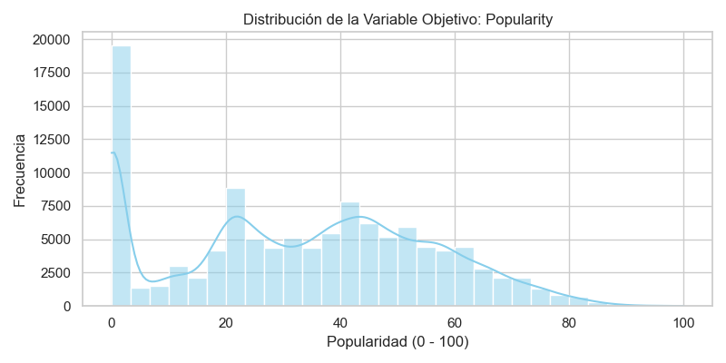

* Distribución **no normal**: media 33,3 y mediana 35, con un pico marcado en 0 y otros dos modos cerca de 20 y 42.
* **15.843 canciones (14,0%) tienen `popularity = 0`.**
* Solo **4.843 canciones (4,3%) superan 70** (hits): clase escasa para el KPI de detección.

#### D.2 Duración de las canciones

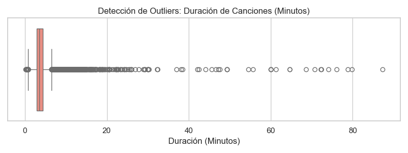

* La mayoría dura entre ~3 y ~4,5 minutos, pero hay una cola larga hacia duraciones muy altas (asimetría 10,8), lo que justifica el umbral extremo usado en la sección C.

#### D.3 Correlaciones entre atributos de audio y popularidad

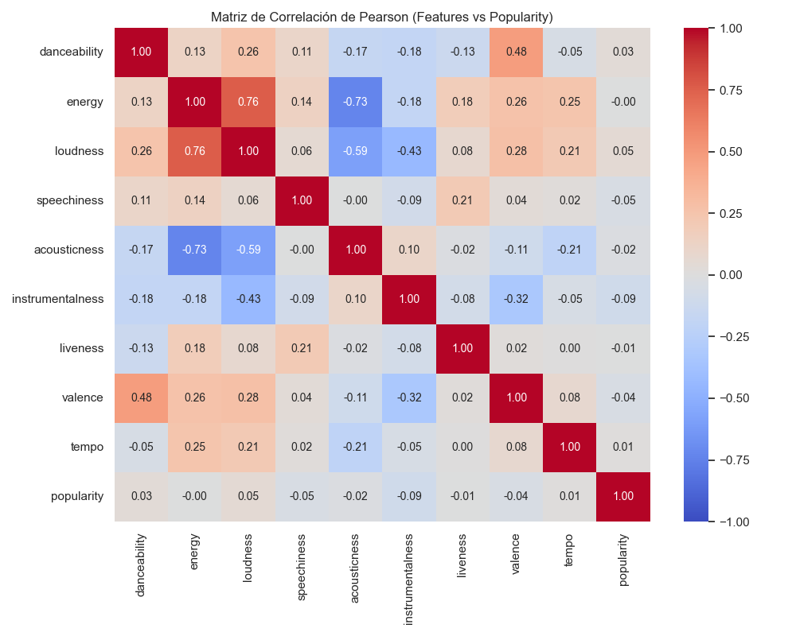

* **Con `popularity`:** ninguna variable de audio supera |r| = 0,095; la mayor es `instrumentalness` (−0,095). Ampliando a `duration_ms`, `explicit`, `key`, `mode` y `time_signature`, y usando Spearman, el máximo sigue siendo bajo (Pearson 0,095; Spearman 0,078): **los atributos de audio no bastan para explicar la popularidad**.
* **Entre los atributos:** `energy`–`loudness` (0,76), `energy`–`acousticness` (−0,73) y `danceability`–`valence` (0,48).

#### D.4 Popularidad por género

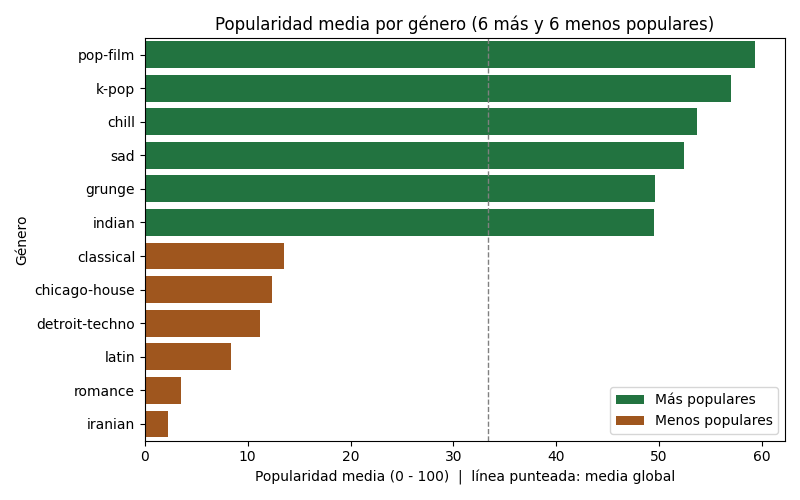

* El género explica **~25% de la varianza** de `popularity` (η² = 0,25), y ~38% si se excluyen los ceros.
* Los géneros más populares son `pop-film` (59,3), `k-pop` (57,0) y `chill` (53,7); los menos, `iranian` (2,2), `romance` (3,5) y `latin` (8,4).
* Los ceros se concentran en ciertos géneros (`jazz` 68%, `iranian` 66%, `romance` 61%, `soul` 61%): parte de la diferencia entre géneros puede deberse a cómo se asigna la popularidad y no solo al gusto de la audiencia.
* Cada género tiene entre 904 y 1.000 canciones (equilibrado por construcción).

### E. Transformación y Encoding de Variables

1. `explicit` se convierte a entero (0 = False, 1 = True).
2. `track_genre` se codifica mediante One-Hot Encoding con `pd.get_dummies(drop_first=True)`, generando 113 variables dummy. La columna `track_genre` se reemplaza por esas dummies, pero se conserva una copia de texto (`track_genre_label`) para reportes por género y para el *target encoding* del modelado; esa copia no es una variable predictora.
3. `key`, `mode` y `time_signature` se conservan como enteros.
4. **Escalamiento:** se aplicó `MinMaxScaler` (Scikit-Learn) sobre las 9 variables continuas de audio, quedando en el rango [0,0, 1,0]. `duration_ms` no se escala en esta etapa (no es un atributo de audio y su tratamiento dependerá del modelo).
5. **Nota metodológica:** el escalador se ajustó aquí con todo el dataset por ser la etapa de preparación. **Se corrigió en el modelado:** se reajusta solo con el conjunto de entrenamiento para evitar fuga de información.

### F. Selección de características

* **Se excluyen como predictoras:** `track_id` (identificador; la partición se agrupa por artista + nombre) y `artists`, `album_name`, `track_name` (texto de alta cardinalidad). Permanecen en el CSV para trazabilidad.
* **Multicolinealidad moderada:** el VIF máximo entre los atributos de audio es 4,2 (`energy`), bajo el umbral habitual de 5, por lo que no se elimina ninguna variable de audio en esta etapa.
* **Selección final: 127 variables predictoras** (9 de audio, 5 discretas o de metadatos y 113 dummies de género). Ninguna cumple un criterio de exclusión (VIF > 5 o ser identificador/texto), por lo que se conservan todas; las dummies de género se mantienen por ser la señal más fuerte.
* **Actualización (EP2):** el primer intento de modelado usa las 127 predictoras, pero el modelo final reemplaza las 113 dummies por una sola variable de *target encoding* del género, quedando **15 predictoras** (sección 6).

### G. Exportación de Datos Procesados

* Dataset limpio y transformado: `data_procesado/spotify_tracks_clean.csv` (113.549 filas y 133 columnas: 19 atributos y metadatos, 113 dummies de género y `track_genre_label`; sin nulos ni duplicados exactos; el notebook incluye validaciones automáticas).
* Registros atípicos identificados: `data_procesado/spotify_tracks_anomalias.csv` (1.256 filas, con columna `anomalia` que indica si corresponde a tempo cero o duración extrema).
* Perfiles sonoros (EP2): `data_procesado/spotify_tracks_clusters.csv` (80.286 canciones distintas con su grupo de K-Means).

## 6. Modelado: preparación para el entrenamiento

Todo se reproduce en la segunda parte de `notebooks/Spotify_Notebook.ipynb` (sección «Modelado (EP2)»: partición, modelos supervisados, evaluación de KPIs y K-Means).

| Paso | Qué se hizo | Justificación |
| :--- | :--- | :--- |
| Compás inválido | Se eliminaron las 1.130 filas con `time_signature` 0 o 1 (quedan 112.419). | Fuera del rango 3-7 de la API de Spotify; se eliminan igual que el único registro nulo del EP1. Este filtro retira también los `tempo = 0`. |
| **Partición por artista + nombre** | `GroupShuffleSplit` 80/20 (`random_state=42`) agrupando por artista + nombre de la canción en minúsculas: 64.228 canciones en train y 16.058 en test. | Agrupar solo por `track_id` dejaba **1.891 canciones en train y test a la vez** (17,8% de las filas de test), porque la misma canción tiene `track_id` distintos (single, álbum, recopilación) con audio casi idéntico en el 90,8% de los casos. Hay asserts que comprueban que no hay fuga. |
| Escalado sin fuga | `MinMaxScaler` ajustado solo con train y aplicado a test. | Corrige el ajuste con todo el dataset del EP1. |
| Hits | `popularity > 70`: 4,3% en train y 4,2% en test (933 filas). | Definición del KPI de detección de hits. |

**Unidad de análisis.** En el modelado cada fila es una canción en un género (canción × género), no una canción distinta. El MAE, el recall de hits y el porcentaje del catálogo marcado se calculan por fila, y una canción catalogada en varios géneros cuenta varias veces. Por eso la tasa de hits por fila (4,3%) no es igual a la tasa entre canciones distintas (2,9%, sección 8).

### 6.1 Baseline justo: mediana del género

| Baseline | RMSE | MAE |
| :--- | :-: | :-: |
| Media de popularidad por género | 19,25 | 14,14 |
| **Mediana de popularidad por género (oficial)** | 20,65 | **12,85** |

El MAE se minimiza con la mediana, así que la comparación justa para el KPI de MAE es contra la mediana (contra la media, cualquier modelo parece mejor de lo que es).

### 6.2 Modelos supervisados

**Justificación de los modelos**

| Modelo | Por qué se eligió | Configuración | Limitación |
| :--- | :--- | :--- | :--- |
| Baseline: mediana por género | Es el mejor predictor «sin mirar el audio» para el MAE; hace justa la comparación. | Mediana de train por género. | No usa atributos de audio. |
| Regresión Lineal | Modelo interpretable de referencia; muestra si existe una relación lineal entre audio y popularidad (el EDA anticipaba que sería débil). | Sin regularización, 15 predictoras. | No captura interacciones; MAE 14,08. |
| Random Forest (regresión) | No exige linealidad y captura interacciones género × audio; poco sensible a las escalas. | 300 árboles, `max_depth=15`, `min_samples_leaf=5` (limitan el sobreajuste). | Hiperparámetros fijados a mano; sobreajusta (brecha 3,18). |
| Random Forest (clasificador de hits) | El MAE no sirve para una clase escasa (4,3%); se reformula como «¿es hit?» para medir recall. | 150 árboles, `max_depth=12`, `min_samples_leaf=20`, `class_weight="balanced_subsample"`. | Baja precisión con recall alto (ver 7.2). |

* **Regresión Lineal:** modelo base interpretable.
* **Random Forest** (300 árboles, `max_depth=15`, `min_samples_leaf=5`): captura interacciones género × audio que la regresión lineal no ve. Se eligió por el EDA: relaciones débiles variable a variable (|r| ≤ 0,10) pero con género explicando ~25% de la varianza. Los hiperparámetros se fijaron a mano (no se hizo una búsqueda sistemática).
* **Primer intento, con 127 predictoras (113 dummies de género):** empeora al baseline (Regresión Lineal 14,05 y Random Forest 16,71 de MAE).
* **Corrección: target encoding del género.** Las 113 dummies se reemplazan por una sola variable (promedio de popularidad del género calculado solo con train), quedando **15 predictoras**. El Random Forest pasa de 16,71 a 13,64 de MAE. **Ojo:** el primer Random Forest usaba 100 árboles con `max_features="sqrt"` y el final usa 300 árboles con todas las variables, así que esa mejora no se debe solo al encoding; no se reentrenó el primer modelo con la configuración final.
* **Limitación del target encoding:** se calcula con todo el train y sin validación cruzada, así que cada canción aporta a su propio promedio de género. Con ~900 canciones por género el aporte es mínimo. Se comprobó con una versión *out-of-fold* (`GroupKFold`): MAE 13,80 vs 13,62, es decir, el encoding usado es levemente optimista, sin cambiar la conclusión.

| Modelo (15 predictoras) | RMSE | MAE | Mejora MAE vs baseline mediana |
| :--- | :-: | :-: | :-: |
| Baseline mediana género | 20,65 | 12,85 | — |
| Baseline media género | 19,25 | 14,14 | −10,0% |
| Regresión Lineal | 19,17 | 14,08 | −9,5% |
| Random Forest | 18,91 | 13,64 | −6,1% |

* **Sobreajuste:** Random Forest MAE train 10,46 vs test 13,64 (brecha 3,18); la Regresión Lineal no sobreajusta (brecha −0,08) pero tampoco mejora.
* **Importancia de variables:** el género codificado concentra ~50%; cada variable de audio aporta entre 3% y 5,4%.

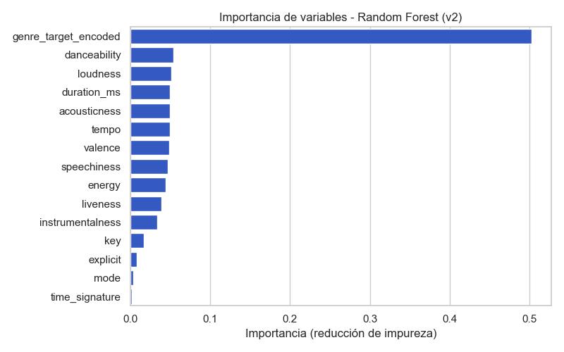

## 7. Evaluación de los KPIs

| KPI | Meta | Resultado | Cumple |
| :--- | :--- | :--- | :-: |
| MAE vs baseline (mediana del género) | ≥ 20% de mejora | **−6,1%** (RF 13,64 vs 12,85) | No |
| Hit Recall, umbral que maximiza F1 | ≥ 60% | 35,3% (precisión 14,4%) | No |
| Hit Recall, umbral calibrado en train para 60% | ≥ 60% | 65,0% (precisión 9,8%, marca 27,7% del catálogo) | Sí, a costa de precisión |
| Diferencia de MAE entre géneros | ≤ 10 puntos | 32,0 puntos | No |

### 7.1 MAE

Un gradient boosting optimizado directamente para MAE llega a 12,84, o sea **empata** con el baseline. El problema no es la función de pérdida: el audio no agrega información sobre el género.

### 7.2 Detección de hits

Clasificador Random Forest (`class_weight="balanced_subsample"`) con las mismas 15 predictoras. Los umbrales se eligen **solo con entrenamiento**, con probabilidades *out-of-fold* (`GroupKFold`, 5 pliegues y género codificado dentro de cada pliegue).

| Umbral | Recall hits | Precisión | % del catálogo marcado | Lift vs azar |
| :--- | :-: | :-: | :-: | :-: |
| F1 (0,602) | 35,3% | 14,4% | 10,2% | 3,5× |
| Recall 60% en train (0,490) | 65,0% | 9,8% | 27,7% | 2,3× |

ROC-AUC 0,779 y PR-AUC 0,147 (tasa base 4,2%). Usar el regresor como detector (predicción > 70) encuentra solo el 0,5% de los hits.

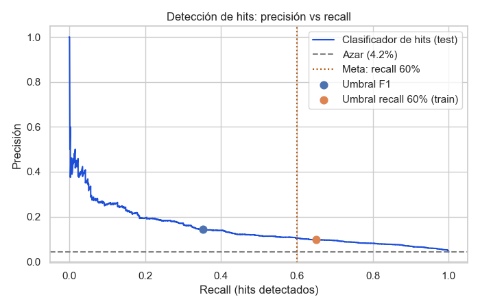

### 7.3 Error por género

Mejor género `iranian` (MAE 2,4) y peor `electro` (34,4). El modelo mejora al baseline en solo 40 de 114 géneros y empeora mucho en algunos (`dance` 33,8 vs 20,2; `alternative` 31,3 vs 23,1). Los géneros con error bajo tienen popularidades muy parecidas entre sí (desviación de 4 a 5 puntos); los de error alto mezclan canciones muy populares con muchos ceros (desviación de 33 a 35 puntos, 30-48% de ceros).

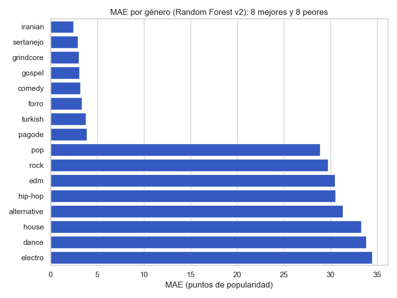

### 7.4 Modelo con y sin los `popularity = 0`

Se entrena el mismo Random Forest solo con canciones de `popularity > 0` (el *target encoding* y el baseline de mediana se recalculan con esos datos) y se evalúan ambos modelos en la prueba completa y en la prueba sin ceros. Cada uno se compara con su propio baseline.

| Entrenamiento | Evaluación | MAE modelo | MAE baseline | Mejora | Dif. mejor-peor género | Géneros que mejoran al baseline |
| :--- | :--- | :-: | :-: | :-: | :-: | :-: |
| Con ceros | Prueba completa | 13,64 | 12,85 | −6,1% | 32,0 | 40 de 114 |
| Sin ceros | Prueba completa | 14,54 | 14,76 | +1,4% | 40,6 | 58 de 114 |
| Con ceros | Prueba sin ceros | 11,13 | 11,01 | −1,1% | 35,4 | 42 de 114 |
| Sin ceros | Prueba sin ceros | 10,11 | 10,11 | 0,0% | 35,5 | 51 de 114 |

* **Entrenar sin ceros empeora el error real** (14,54 vs 13,64) y amplía la brecha entre géneros (40,6 vs 32,0). Su «mejora» de 1,4% es contra un baseline peor que la mediana con ceros (12,85).
* **Los ceros se concentran en ciertos géneros:** al quitarlos, `jazz` (+13,3 de MAE, 68% de ceros), `soul` (+12,9), `country` (+10,7) y `latin` (+8,6) empeoran mucho; los géneros con pocos ceros mejoran levemente (hasta −2,4). La correlación entre % de ceros y cambio de MAE es 0,78.
* **Sin ceros en la prueba, el modelo iguala a su baseline (0,0%):** el audio no mejora la regla de mediana por género ni siquiera cuando se excluyen los ceros.
* **La equidad no se arregla quitando ceros:** la diferencia sigue en ~35 puntos y `dance` es el peor género en tres de las cuatro combinaciones.
* **Decisión:** se mantiene el entrenamiento con ceros y se recomienda reportar el error también sin ellos. Falta aclarar con el negocio qué significa `popularity = 0`.

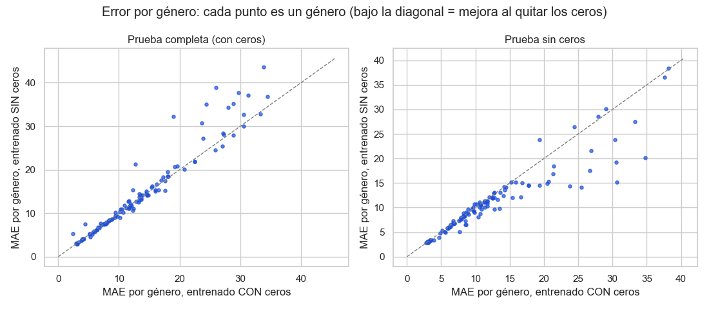

## 8. Aprendizaje no supervisado: perfiles sonoros con K-Means

**Para qué:** agrupar el catálogo en perfiles sonoros, sin usar `popularity` ni el género, para organizar playlists y campañas. La popularidad se usa solo después, para interpretar los grupos.

**Datos:** una fila por canción distinta (80.286, por artista + nombre), las 9 variables de audio más la duración en logaritmo, **estandarizadas** (`StandardScaler`) y leídas en sus unidades originales desde el CSV crudo. Sin `tempo = 0` (ya retirados por el filtro de compás).

**Por qué K-Means:** con 80.286 canciones y 10 variables numéricas estandarizadas, K-Means escala bien, entrega centroides legibles en unidades de negocio (BPM, dB, minutos) y es estable entre semillas. El clustering jerárquico (Ward) requiere una matriz de distancias de orden n², inviable a esta escala sin muestrear, y las mezclas gaussianas son más difíciles de explicar a un equipo de programación. Esas alternativas no se ejecutaron en este informe: la elección es de diseño, no un resultado experimental.

**Elección de k:** codo, silueta y Davies-Bouldin para k = 2 a 10. La silueta es máxima en k = 2 (0,24), muy grueso para el negocio; desde k = 3 queda entre 0,15 y 0,17 sin máximo claro y el codo no es marcado. Se elige **k = 5** por interpretabilidad y manejabilidad (el grupo más pequeño, «En vivo / hablado», tiene 7,8% del catálogo). **La silueta de k = 5 es baja (≈ 0,16): los atributos de audio forman un continuo y los grupos se solapan; son una segmentación útil, no categorías naturales.** Con otras semillas se obtienen los mismos grupos (ARI ≥ 0,99).

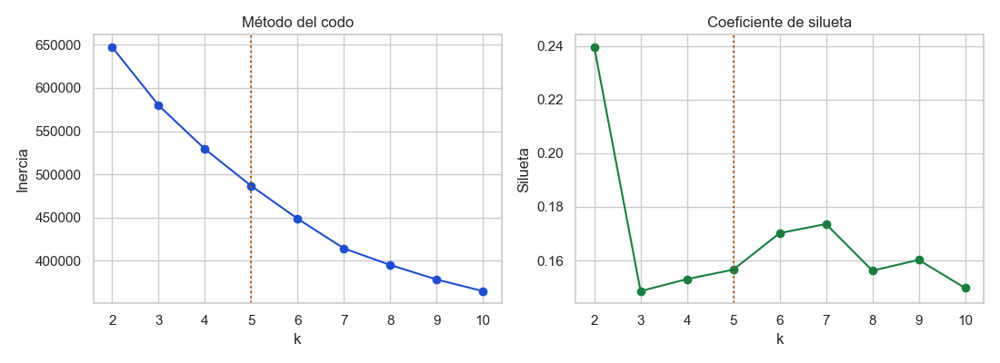

| Perfil | Cómo suena | % del catálogo | % hits |
| :--- | :--- | :-: | :-: |
| **Bailable y alegre** | Bailabilidad 0,69, valencia 0,70, energía alta, poca acústica | 34,3% | **4,6%** |
| **Acústico moderado** | Energía 0,39, acousticness 0,67, ~114 BPM | 21,4% | 2,8% |
| **Energético e intenso** | Energía 0,81, casi sin acústica, ~135 BPM, 4,1 min | 28,5% | 2,2% |
| **En vivo / hablado** | Liveness 0,75 y speechiness 0,21 | 7,8% | 1,0% |
| **Acústico e instrumental** | −20,8 dB, instrumentalness 0,78, acousticness 0,84 | 8,0% | 0,3% |

Tasa global de hits entre canciones distintas: 2,9%.

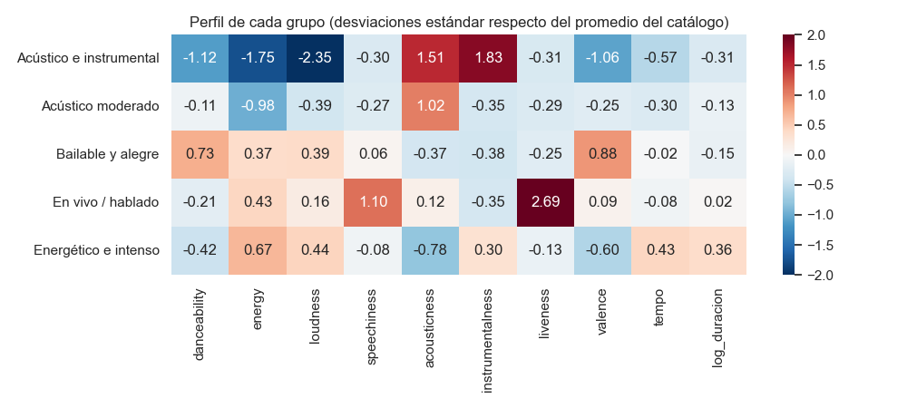
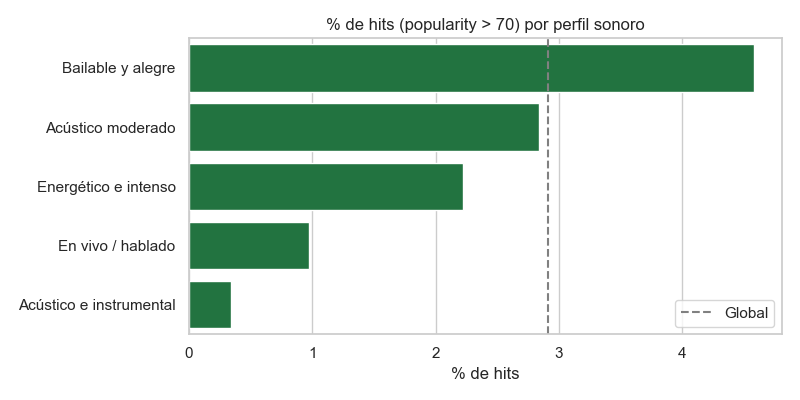
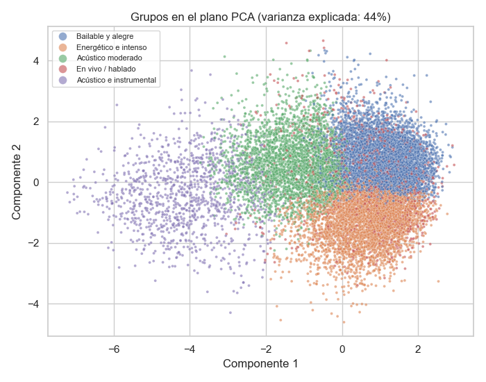

**Cómo leer el plano PCA.** El PCA (análisis de componentes principales) resume las 10 variables estandarizadas del clustering (9 de audio y la duración en logaritmo) en unos pocos ejes nuevos, ordenados por cuánta variación del catálogo recogen. El gráfico muestra solo los dos primeros, que juntos recogen el **44% de la varianza**. Por lo tanto el 56% restante queda fuera del gráfico: dos canciones que se ven cerca pueden diferir en otras dimensiones, y los grupos parecen más solapados de lo que están en las 10 dimensiones originales (coherente con la silueta baja de ≈ 0,16). Con 3 componentes se llega al 57% y se necesitan 6 para superar el 80% (se calcula en el notebook, celda «PCA: varianza acumulada y cargas»). Eso confirma que los atributos de audio no se resumen bien en dos dimensiones.

Cada eje es una combinación de variables, no una variable en sí:

* **Eje 1 (componente 1): intensidad sonora.** Contrapone las canciones fuertes y energéticas (`energy`, `loudness`) a las suaves y acústicas (`acousticness`, `instrumentalness`). Es el mismo patrón que el EDA ya había encontrado entre estas variables (`energy`–`loudness` 0,76, `energy`–`acousticness` −0,73). Separa, por ejemplo, el perfil «Energético e intenso» del «Acústico e instrumental».
* **Eje 2 (componente 2): ánimo y ritmo.** Agrupa `danceability` y `valence`: canciones bailables y alegres en un extremo y más tranquilas o sombrías en el otro. Es independiente del eje 1 (por construcción los ejes del PCA no están correlacionados).

El PCA se usa solo para **visualizar** los grupos: K-Means se ajustó sobre las 10 variables completas, no sobre estos dos ejes.

**Interpretación:** los perfiles se alinean con el género (por ejemplo, el acústico e instrumental agrupa `new-age`, `ambient`, `sleep` y `classical`). **El perfil sonoro explica muy poco de la popularidad (η² = 0,011, frente a 0,379 del género sobre las mismas canciones):** sirve para organizar el catálogo, no para predecir hits.

**Uso en el negocio:** armar playlists por perfil (contextos de uso distintos); priorizar «Bailable y alegre» para campañas de difusión; tratar «Acústico e instrumental» y «En vivo / hablado» como nichos de contexto y no medirlos con la misma vara de éxito. Que un perfil tenga más hits no prueba que sonar así cause la popularidad: está mezclado con el género y la exposición.

## 9. EP3: Optimización, ensambles y selección de la solución óptima

Todo lo descrito aquí se reproduce en la sección «EP3» de `notebooks/Spotify_Notebook.ipynb` (Pasos 0 a 8), ejecutada con `RAPIDO = False`.

### 9.1 Foco del modelado y KPIs de la EP3

En la EP2 el modelo de regresión no superó a la regla simple de la mediana del género (MAE 13,64 vs 12,85) y el resultado más útil fue el **clasificador de hits** (`popularity > 70`, 4,3% de las canciones de entrenamiento). Por eso la EP3 optimiza y compara modelos de **clasificación de hits**, y la regresión queda como análisis de apoyo (sección 9.7) para confirmar con validación cruzada que el audio aporta poco.

Como solo ~4,3% de las canciones son hits, la métrica principal es el **PR-AUC** (*average precision*), cuyo valor para un modelo que adivina al azar es la tasa base (0,043 en train y 0,042 en test). La *accuracy* no sirve: un modelo que nunca marca hits tendría ~96%.

| KPI de la EP3 | Meta (propuesta del grupo) | Resultado | Estado |
| :--- | :--- | :--- | :--- |
| PR-AUC del modelo final en test | ≥ 0,147 (igualar o superar al Random Forest de la EP2) | 0,225 (Voting), unas 5,4 veces la tasa base | Cumplido |
| Hit Recall con umbral calibrado en train | ≥ 60% (igual que la EP2) | 63,6% en test (precisión 18,4%; marca 14,4% del catálogo) | Cumplido |
| Aporte de la optimización de hiperparámetros | Mejora de PR-AUC en CV mayor que la desviación entre pliegues | Random Forest +0,020 (desviación 0,022); XGBoost +0,008 (desviación 0,024) | Parcial: no supera la desviación, aunque reduce el sobreajuste |
| Aporte del ensamble | El mejor ensamble supera al árbol individual por más de una desviación | Voting +0,040 sobre el árbol (desviación 0,020) | Cumplido frente al árbol; sin ventaja significativa frente al mejor modelo individual |
| Generalización | Brecha train–CV del modelo elegido menor que la del Random Forest inicial | 0,150 vs 0,254 | Cumplido |

### 9.2 Estado del arte y comparación con otros trabajos

Antes de elegir los modelos se revisó qué se ha hecho con datos parecidos. **Los trabajos no son directamente comparables** (datasets, definición de «hit» y métricas distintas), por lo que sirven para justificar las decisiones y para ubicar el resultado, no para comparar cifras una a una.

| Trabajo | Datos y definición de hit | Modelos | Qué aporta a este proyecto |
| :--- | :--- | :--- | :--- |
| Middlebrook y Sheik (2019), *Song Hit Prediction: Predicting Billboard Hits Using Spotify Data* ([arXiv:1908.08609](https://arxiv.org/abs/1908.08609)) | ~1,8 millones de canciones de Spotify cruzadas con el Billboard Hot 100; hit = aparece en el ranking; conjunto balanceado 12.000 hits y 12.000 no hits. | Regresión logística, red neuronal, Random Forest y SVM. | Reportan al Random Forest como el mejor modelo (88% de *accuracy*, sobre datos balanceados). Respalda usar Random Forest, y muestra por qué aquí se usa PR-AUC: nuestros datos no están balanceados. |
| Dawson, Mann, Roske y Vasseur (2021), *Spotify: You have a Hit!*, SMU Data Science Review ([enlace](https://scholar.smu.edu/datasciencereview/vol5/iss3/9)) | Más de 400.000 canciones de la API de Spotify; hit = popularidad > 90. | LASSO y XGBoost. | Respalda XGBoost como modelo de boosting para este problema. |
| Cabansag y Ntegeka (2025), *Prediction of Spotify Chart Success Using Audio and Streaming Features* ([arXiv:2508.11632](https://arxiv.org/abs/2508.11632)) | 14.639 canciones del Top 200 diario de EE. UU. 2024, con atributos de audio y datos tempranos de interacción. | Pipeline de clasificación del éxito en ranking. | Incorpora datos de interacción además del audio, en línea con nuestra recomendación de sumar datos del artista y de exposición. |
| Trabajos de curso con el mismo dataset de Kaggle (`maharshipandya`): informe del Erdős Institute y un proyecto publicado en RPubs | Mismo *Spotify Tracks Dataset*; clasificación de canciones populares / hits (popularidad ≥ 70 en el proyecto de RPubs). | Modelos de clasificación (en el RPubs, tres clasificadores bajo fuerte desbalance). | Plantean la misma pregunta, incluido el límite de predecir solo con audio. Son trabajos de curso, no revisados por pares: citarlos como referencia y no como evidencia concluyente. |

**Conclusión de la revisión:** los ensambles de árboles (Random Forest y XGBoost) son la elección habitual para este tipo de problema, por lo que se comparan aquí como bagging y boosting. Varios trabajos incorporan información que no es de audio (interacción, artista, ranking) para mejorar el resultado, lo que coincide con nuestra conclusión de que el audio y el género explican poco. Nuestro ROC-AUC de la EP2 (0,78) y el del modelo final (0,878 en test) deben leerse con esa cautela. *[Antes de la defensa, abrir cada fuente y confirmar que la descripción coincide con lo que dicen; ajustar si algo difiere.]*

### 9.3 Diseño experimental

* **Validación agrupada:** `GroupKFold` de 5 pliegues, agrupando por artista + nombre de la canción (la misma regla anti-fuga de la EP2). **Los mismos pliegues se usan para todos los modelos**, para que la comparación sea justa.
* **Género sin fuga:** el género entra como etiqueta y se codifica con `TargetEncoder` **dentro de cada pliegue** (dentro de un `Pipeline`), no con un promedio calculado sobre todo el train.
* **Datos:** 89.993 canciones en train y 22.426 en test, con 14 variables numéricas (9 de audio y 5 discretas o de metadatos) más el género (15 predictoras). Hits: 4,33% en train y 4,2% en test.
* **Uso del test:** no se usa para elegir hiperparámetros ni modelo. Se consulta solo en la importancia por permutación (Paso 3, explicativa) y en la comparación final del Paso 7.
* **Umbrales:** se calibran solo con probabilidades *out-of-fold* del entrenamiento, igual que en la EP2.

### 9.4 Bagging: árbol de decisión vs Random Forest (Paso 1)

| Modelo | PR-AUC | ROC-AUC | Recall (hit) | Precisión (hit) | % marcado como hit |
| :--- | :-: | :-: | :-: | :-: | :-: |
| Azar (tasa base) | 0,043 | 0,50 | — | — | — |
| Árbol de decisión (`max_depth=6`, `min_samples_leaf=50`) | 0,180 | 0,849 | 87,1% | 11,4% | 33,2% |
| Random Forest (150 árboles) | 0,182 | 0,860 | 76,2% | 14,0% | 23,6% |

*(Predicciones out-of-fold de 5 pliegues agrupados, umbral 0,5; PR-AUC calculado sobre todas las predicciones juntas, por lo que difiere levemente del promedio por pliegue de la sección 9.7.)*

**Interpretación:** un árbol individual tiene alta varianza: cambia mucho si cambian los datos. El Random Forest entrena muchos árboles con muestras *bootstrap* y subconjuntos de variables y promedia sus votos, por lo que los errores individuales se cancelan. El Random Forest supera al árbol en PR-AUC (+0,002 en esta tabla y +0,016 en el promedio por pliegue de la sección 9.7, donde gana en 4 de los 5 pliegues) y, con el mismo umbral, marca menos canciones (23,6% frente a 33,2%) con mayor precisión. Con `class_weight="balanced"` ambos modelos marcan muchas canciones como hit, así que el recall es alto y la precisión baja.

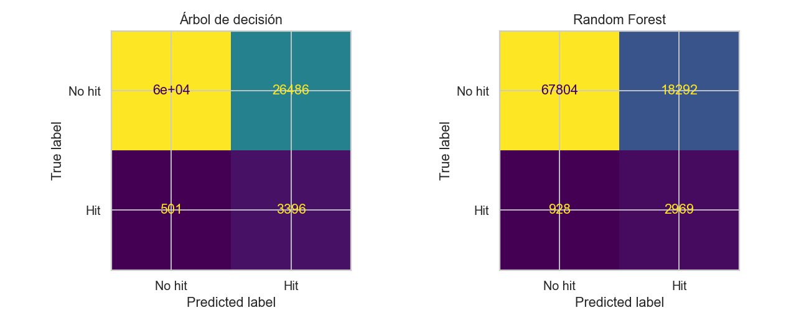

### 9.5 Boosting: XGBoost estándar vs ponderado (Paso 2)

| Modelo | PR-AUC | Recall (hit) | Precisión (hit) | % marcado como hit |
| :--- | :-: | :-: | :-: | :-: |
| XGBoost estándar | 0,200 | 1,0% | 40,4% | 0,1% |
| XGBoost ponderado (`scale_pos_weight` ≈ 22 = no-hits / hits) | 0,193 | 73,0% | 14,0% | 22,6% |

**Interpretación:** el boosting entrena árboles en secuencia, cada uno corrigiendo los errores del anterior, y reduce principalmente el **sesgo** (el bagging reduce la **varianza**). Con solo ~4,3% de hits, el XGBoost estándar casi nunca marca un hit a umbral 0,5 (recall 1,0%, marca solo 0,1% de las canciones). Pero su PR-AUC es igual de bueno (0,200 vs 0,193): **el ponderado no «aprende mejor», solo mueve el umbral de decisión**. Por eso en el Paso 7 el umbral se elige explícitamente según el negocio. Se usa el ponderado como referencia porque entrega un recall alto sin ajustar el umbral.

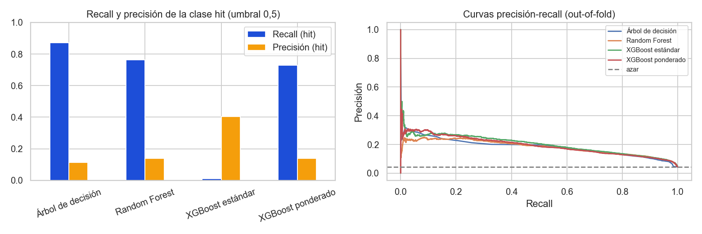

### 9.6 Importancia de variables (Paso 3)

Se calcula con dos métodos sobre el Random Forest: reducción de impureza (MDI), que se sesga hacia variables continuas, e importancia por permutación en test (caída del PR-AUC al barajar una columna). Los valores siguientes están leídos de los gráficos.

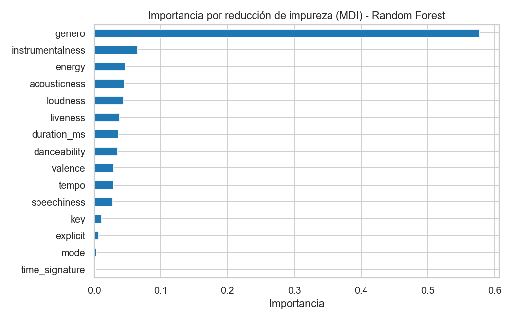
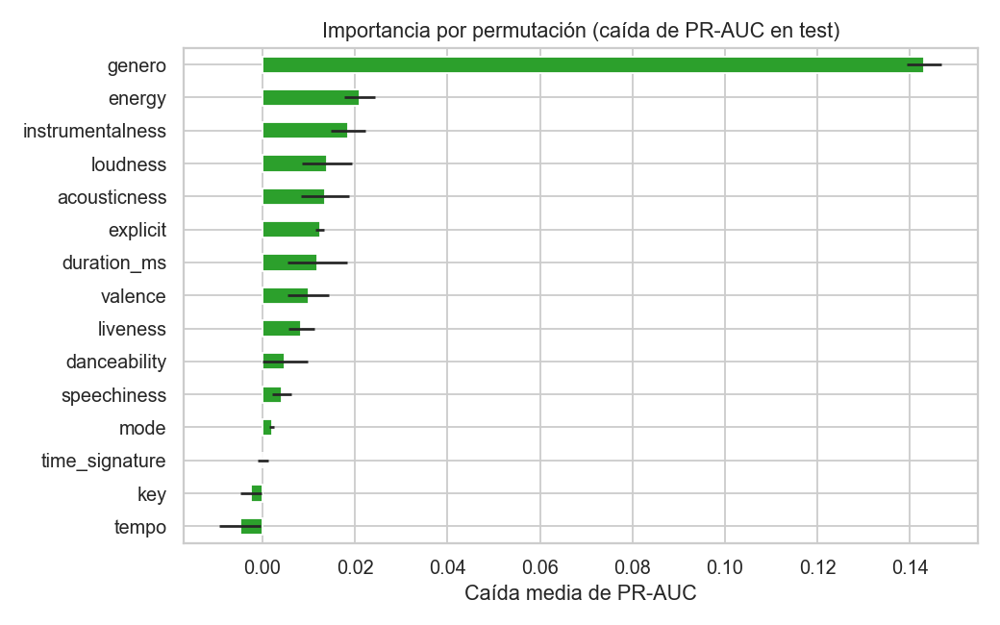

* **El género domina con ambos métodos:** ~0,58 de la importancia MDI y una caída de ~0,143 en PR-AUC al barajarlo, unas siete veces más que cualquier otra variable.
* **Después del género los métodos no coinciden:** MDI pone `instrumentalness`, `energy` y `loudness`/`acousticness` (~0,045 a 0,065 cada una); la permutación pone `energy` (~0,021), `instrumentalness` (~0,018) y `loudness` (~0,014). Cada atributo de audio aporta muy poco (caídas menores a 0,025), consistente con las correlaciones |r| ≤ 0,10 del EDA.
* **MDI infla variables continuas:** `tempo` aparece en el medio del ranking MDI (~0,03), pero su permutación es negativa (barajarlo mejora levemente el PR-AUC), es decir, el modelo usa `tempo` para ajustar ruido. `key`, `mode` y `time_signature` no aportan.

**Decisiones de negocio:** 1) géneros a priorizar para difusión: pop (29,5%), dance (26,1%), electro (21,9%), house (20,6%), k-pop (19,3%), metal (18,5%), rock (18,5%), indie (17,3%), latino (17,0%), edm (16,9%); 2) perfil sonoro (K-Means) que acompaña a más hits: «Bailable y alegre» (4,6% de hits frente a 2,9% global, sección 8); 3) datos que faltan para mejorar el modelo: popularidad o seguidores del artista y fecha de lanzamiento.

### 9.7 Validación cruzada y capacidad de generalización (Paso 4)

| Modelo | PR-AUC CV (media ± desv.) | ROC-AUC CV | PR-AUC train | Brecha train–CV | Segundos |
| :--- | :-: | :-: | :-: | :-: | :-: |
| Árbol de decisión | 0,171 ± 0,007 | 0,849 | 0,186 | 0,015 | 2 |
| Random Forest (configuración inicial) | 0,187 ± 0,022 | 0,860 | 0,441 | 0,254 | 54 |
| XGBoost ponderado (configuración inicial) | 0,198 ± 0,024 | 0,859 | 0,527 | 0,329 | 11 |

PR-AUC por pliegue: árbol [0,176 0,172 0,180 0,161 0,169]; Random Forest [0,163 0,188 0,219 0,163 0,201]; XGBoost [0,184 0,191 0,238 0,168 0,210].

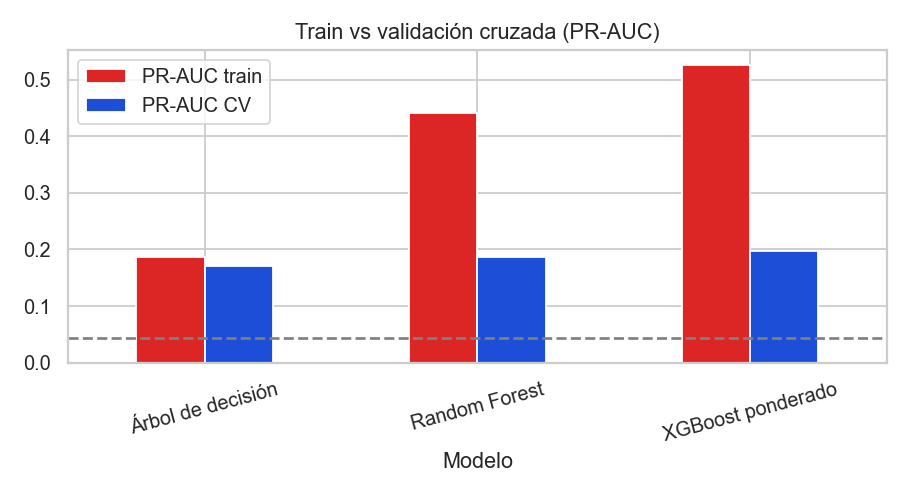

**Estabilidad:** la desviación entre pliegues (0,007 a 0,024) equivale a entre 4% y 12% de la media; en Random Forest y XGBoost supera el 5% usado como referencia. Pero los tres modelos suben y bajan juntos (el pliegue 4 es el más difícil y el 3 el más fácil para todos), por lo que la variación viene sobre todo de la dificultad de cada pliegue y no del modelo. Las diferencias entre modelos son bastante consistentes: el Random Forest supera al árbol en 4 de los 5 pliegues y XGBoost supera al Random Forest en los 5. **Sobreajuste:** el árbol casi no sobreajusta (brecha 0,015) pero rinde menos; Random Forest y XGBoost sobreajustan mucho en su configuración inicial (train 0,44 y 0,53 contra ~0,19 y ~0,20 en CV). La optimización de la sección 9.8 ataca precisamente este problema.

**Regresión de apoyo (popularidad 0–100).** Con la misma validación agrupada, el MAE del Random Forest es 13,86 ± 0,11 frente a 13,08 ± 0,17 del baseline de mediana por género: **−5,9%** (la meta del KPI era ≥ 20%), con un MAE de entrenamiento de 10,75 (brecha 3,11 puntos). Se confirma el −6,1% de la EP2: el audio no mejora la predicción de la popularidad y el valor del proyecto está en el clasificador de hits.

### 9.8 Optimización de hiperparámetros (Paso 5)

Se usa `RandomizedSearchCV` (15 configuraciones × 5 pliegues agrupados = 75 ajustes por modelo), optimizando PR-AUC. Se eligió búsqueda aleatoria y no una grilla porque, con el mismo presupuesto de cálculo, prueba más valores distintos de cada hiperparámetro.

| Modelo | Hiperparámetro | Rango explorado |
| :--- | :--- | :--- |
| Random Forest | `n_estimators` | 100 a 399 |
| | `max_depth` | 6 a 24 |
| | `min_samples_leaf` | 5 a 79 |
| | `max_features` | `sqrt`, 0,3, 0,5, 0,8 |
| XGBoost | `n_estimators` | 100 a 499 |
| | `learning_rate` | 0,01 a 0,2 (escala logarítmica) |
| | `max_depth` | 3 a 8 |
| | `subsample` y `colsample_bytree` | 0,6 a 1,0 |
| | `min_child_weight` | 1 a 19 |
| | `reg_lambda` | 0,1 a 10 (escala logarítmica) |

| Modelo | PR-AUC CV antes | PR-AUC CV optimizado | Mejora | Brecha train–CV (antes → después) | Mejores parámetros |
| :--- | :-: | :-: | :-: | :-: | :--- |
| Random Forest | 0,1867 | 0,2067 | +0,0199 | 0,254 → 0,223 | `max_depth=15`, `max_features=0.8`, `min_samples_leaf=64`, `n_estimators=370` |
| XGBoost | 0,1982 | 0,2060 | +0,0079 | 0,329 → 0,220 | `learning_rate=0.0475`, `max_depth=4`, `min_child_weight=4`, `n_estimators=409`, `reg_lambda=0.1155`, `subsample=0.9369`, `colsample_bytree=0.7247` |

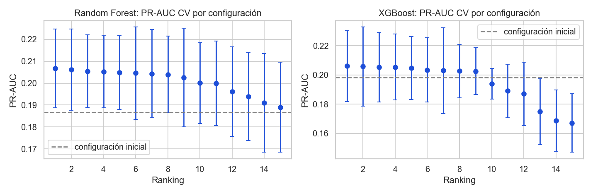

**Justificación de las decisiones:** los mejores modelos están más regularizados que los iniciales. En Random Forest el óptimo usa hojas mucho más grandes (64 en vez de 20), aunque árboles algo más profundos (15 en vez de 12); la asociación de Spearman entre hiperparámetro y PR-AUC es +0,69 para `min_samples_leaf` y solo −0,09 para `max_depth`, es decir, el tamaño mínimo de hoja es lo que más influye. En XGBoost el óptimo usa una tasa de aprendizaje baja (0,05; Spearman −0,48) y árboles poco profundos (4; −0,34). Es coherente con la sección 9.7: como la señal es débil, el principal riesgo es memorizar ruido, y limitar la complejidad reduce la brecha train–CV (de 0,254 a 0,223 en Random Forest y de 0,329 a 0,220 en XGBoost). Según el gráfico, la configuración inicial queda al fondo del ranking en Random Forest (las 15 configuraciones la superan) y en la parte media en XGBoost (unas 9 de 15).

**Limitaciones:** (1) la mejora de PR-AUC es pequeña: 0,020 en Random Forest (cercana a una desviación entre pliegues) y 0,008 en XGBoost (menor que su desviación), y las barras de error de las mejores configuraciones se solapan, por lo que no se puede distinguir entre ellas; (2) el mejor de 15 configuraciones queda favorecido en la validación cruzada (sesgo de selección), por eso la comparación final se confirma en el test del Paso 7; (3) `n_iter` es limitado y una búsqueda mayor podría mejorar levemente (la búsqueda de Random Forest tardó ~36 minutos y la de XGBoost ~3).

### 9.9 Ensambles: Voting y Stacking (Paso 6)

Con los modelos optimizados se comparan tres familias: **bagging** (Random Forest), **boosting** (XGBoost) y **combinación de modelos distintos**. *Voting* promedia las probabilidades de Random Forest, XGBoost y regresión logística; *Stacking* entrena un metamodelo (regresión logística) que aprende a combinar las predicciones de esos tres modelos, generadas con validación agrupada para no filtrar información.

| Modelo | PR-AUC CV (media ± desv.) | ROC-AUC CV | Brecha train–CV | Segundos (validación cruzada) |
| :--- | :-: | :-: | :-: | :-: |
| Regresión logística (referencia) | 0,203 ± 0,010 | 0,857 | 0,002 | 2 |
| Árbol de decisión (referencia) | 0,171 ± 0,007 | 0,849 | 0,015 | 2 |
| Random Forest optimizado (bagging) | 0,207 ± 0,018 | 0,866 | 0,223 | 386 |
| XGBoost optimizado (boosting) | 0,206 ± 0,024 | 0,862 | 0,220 | 14 |
| Voting (RF + XGB + LR) | **0,212 ± 0,020** | 0,868 | 0,150 | 410 |
| Stacking (RF + XGB + LR) | 0,211 ± 0,021 | 0,868 | 0,202 | 1933 |

**Aporte del ensamble:** el mejor ensamble (Voting) supera al árbol individual por **0,040 puntos de PR-AUC** (dos desviaciones), un aporte claro de combinar muchos árboles. Bagging y boosting rinden igual (0,207 vs 0,206) y sobreajustan parecido (brecha 0,223 vs 0,220), pero XGBoost entrena unas 28 veces más rápido. **Combinar modelos distintos no aporta de forma significativa:** Voting (+0,005) y Stacking (+0,004) quedan dentro de la desviación frente al mejor modelo individual, aunque Voting sobreajusta menos (brecha 0,150); Stacking cuesta 1.933 segundos. Además, la **regresión logística** (0,203, entrenada en 2 segundos) queda también dentro del margen de error de los ensambles, lo que indica que gran parte de la señal es simple (principalmente el género) y que los modelos complejos agregan poco.

### 9.10 Generalización final y selección de la solución óptima (Paso 7)

Cada finalista se reentrena con todo el train y se evalúa **una vez** en el test. La decisión combina desempeño en CV, estabilidad (desviación), brecha train–CV, consistencia con el test, costo de entrenamiento e interpretabilidad.

| Modelo | PR-AUC CV | ± | Brecha train–CV | PR-AUC test | Dif. CV vs test | ROC-AUC test | Segundos | ¿Distinto del mejor en CV? |
| :--- | :-: | :-: | :-: | :-: | :-: | :-: | :-: | :--- |
| **Voting (RF + XGB + LR)** | 0,212 | 0,020 | 0,150 | 0,225 | +0,013 | 0,878 | 410 | mejor en CV |
| Stacking (RF + XGB + LR) | 0,211 | 0,021 | 0,202 | 0,225 | +0,014 | 0,878 | 1933 | empate técnico |
| Random Forest optimizado (bagging) | 0,207 | 0,018 | 0,223 | 0,224 | +0,017 | 0,876 | 386 | empate técnico |
| XGBoost optimizado (boosting) | 0,206 | 0,024 | 0,220 | 0,216 | +0,010 | 0,872 | 14 | empate técnico |
| Regresión logística | 0,203 | 0,010 | 0,002 | 0,212 | +0,009 | 0,869 | 2 | empate técnico |
| Árbol de decisión | 0,171 | 0,007 | 0,015 | 0,174 | +0,003 | 0,862 | 2 | peor |

**Solución elegida: Voting (Random Forest + XGBoost + regresión logística).** Es la mejor en PR-AUC CV (0,212) y empata con Stacking en ROC-AUC CV (0,868); empata con Stacking en el mejor ROC-AUC en test (0,878) y en el mejor PR-AUC en test (0,225); su brecha train–CV (0,150) es la menor entre los ensambles de árboles; y promedia tres modelos de naturaleza distinta, lo que lo hace más estable que depender de uno solo. Frente a Stacking, rinde igual con una quinta parte del tiempo. **Se reconoce que es un empate técnico:** Random Forest, XGBoost y Stacking están dentro de una desviación del Voting, por lo que la elección se apoya en el mejor rendimiento combinado más que en una ventaja significativa. El costo (~400 segundos de validación cruzada) es aceptable porque el modelo se usa en lote para armar una lista corta. Si se priorizara la velocidad, XGBoost optimizado (14 segundos, PR-AUC test 0,216) es la alternativa; si se priorizara la interpretabilidad, la regresión logística (2 segundos, PR-AUC test 0,212).

**Consistencia con el test:** todos los modelos rinden unos 0,003 a 0,017 *mejor* en el test que en la CV (Voting +0,013). No hay señal de sobreajuste a la CV: el modelo final se entrena con todo el train (la CV usa 80%) y la curva de aprendizaje todavía sube levemente.

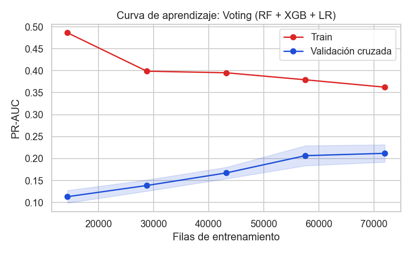

**Curva de aprendizaje (Voting):** el PR-AUC de train baja de ~0,49 a 0,363 y el de validación sube de ~0,11 a 0,212, con lo que la brecha se reduce de ~0,37 a ~0,15. En el último tramo la validación casi se aplana (0,207 → 0,212 al pasar de 80% a 100% de los datos), por lo que **más canciones aportarían poco; el límite lo pone la información disponible** (faltan datos del artista y de la fecha de lanzamiento), no el modelo ni la cantidad de datos.

| Umbral (calibrado solo con train) | Valor | Recall hits | Precisión | % del catálogo marcado | Lift vs azar |
| :--- | :-: | :-: | :-: | :-: | :-: |
| Máximo F1 | 0,740 | 49,1% | 22,1% | 9,3% | 5,3× |
| Recall ≥ 60% | 0,636 | 63,6% | 18,4% | 14,4% | 4,4× |

**Comparación con la EP2** (mismo test): Random Forest de la EP2, PR-AUC 0,147 y ROC-AUC 0,779 (igual que en el informe de la EP2); solución EP3, PR-AUC 0,225 y ROC-AUC 0,878. Con un recall parecido (65,0% en la EP2 y 63,6% ahora), la EP2 debía marcar 27,7% del catálogo con 9,8% de precisión (lift 2,3×), y la solución EP3 marca 14,4% con 18,4% de precisión (lift 4,4×): **la mitad de las canciones por revisar y casi el doble de precisión**. Una explicación probable de la mejora, a confirmar con la prueba de ablación del notebook, es que la EP3 codifica el género con la tasa de hits de cada género dentro de un `Pipeline`, mientras que el modelo de la EP2 lo codificaba con el promedio de popularidad; como el género concentra la señal, esa diferencia pesa mucho.

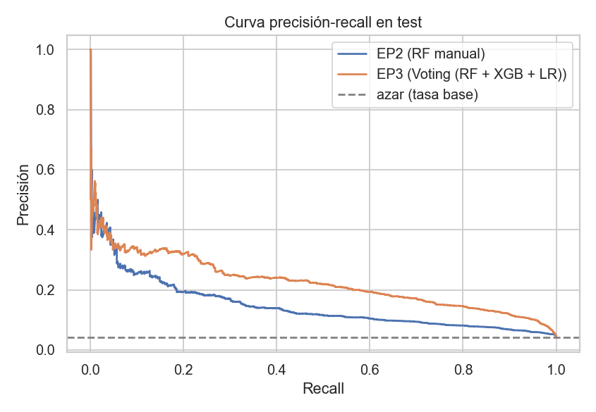

**Cómo explicar recall y precisión (pregunta frecuente en la defensa).** Con el umbral de recall ≥ 60% el modelo encuentra 63 o 64 de cada 100 hits reales (recall). Como marca 14,4% del catálogo y los hits son solo ~4,2%, solo ~18 de cada 100 canciones marcadas son hits (precisión), aun así 4,4 veces mejor que elegir al azar. Para el negocio es una lista corta que revisa una persona; si se quiere más precisión, se sube el umbral (con el umbral F1 la precisión sube a 22,1% y el recall baja a 49,1%).

### 9.11 Conclusiones y recomendaciones de la EP3

1. **Optimización (IE9):** PR-AUC CV de 0,187 a 0,207 (Random Forest) y de 0,198 a 0,206 (XGBoost). La mejora es pequeña; los hiperparámetros más influyentes (hojas más grandes en Random Forest; menor tasa de aprendizaje y menor profundidad en XGBoost) redujeron el sobreajuste (brecha de 0,254 a 0,223 y de 0,329 a 0,220).
2. **Ensambles (IE10):** árbol individual 0,171 frente a Voting 0,212 (+0,040). Combinar muchos árboles (bagging y boosting) mejora claramente al árbol; Voting y Stacking solo empatan con el mejor modelo individual.
3. **Generalización (IE11):** brecha train–CV de 0,150 y diferencia CV vs test de +0,013; la curva de aprendizaje indica que más datos aportarían poco.
4. **Solución elegida (IE12):** Voting (RF + XGBoost + regresión logística), con PR-AUC 0,225 y ROC-AUC 0,878 en test, por mejor rendimiento combinado, consistencia entre CV y test, y estabilidad.
5. **Recomendaciones de negocio:** usar el modelo como filtro previo que arma una lista corta para revisión humana; fijar el umbral según la capacidad de revisión de la campaña (recall ≥ 60% marcando ~14% del catálogo, o máximo F1 marcando ~9%); incorporar datos del artista y la fecha de lanzamiento, que es donde está el mayor potencial de mejora; reportar siempre el error por género.
6. **Limitaciones:** el audio aporta poco y el género concentra la señal; faltan datos de artista y fecha de lanzamiento; la unidad de análisis es canción × género; el significado de `popularity = 0` no está aclarado; la búsqueda de hiperparámetros es acotada (15 configuraciones por modelo) y su resultado en CV es algo optimista; varios modelos empatan técnicamente, incluida la regresión logística, por lo que la ventaja del ensamble elegido es pequeña.
7. **Sesgos y ética:** el modelo reproduce el sesgo de popularidad previo y favorece géneros con más hits históricos; puede perjudicar a artistas emergentes. Usarlo para apoyar y no para decidir automáticamente (sección 11).

## 10. Interpretación y recomendaciones (EP2)

1. **El género domina y el audio aporta poco.** Coincide con el EDA (|r| ≤ 0,10).
2. **El modelo de regresión no supera una regla simple.** El Random Forest mejora el RMSE (18,91 vs 20,65), pero su MAE es peor que la mediana del género; además sobreajusta. No debe usarse para predecir la popularidad exacta de una canción.
3. **Lo más útil es el clasificador de hits**, como filtro previo (*shortlist*) para campañas y no como decisión final. El umbral se fija según la capacidad de la campaña: más recall significa más canciones por revisar y menor precisión (con la meta de 60% de recall, ~1 de cada 10 canciones marcadas es un hit).
4. **Organizar playlists y campañas por perfil sonoro** (K-Means), sabiendo que los perfiles casi no predicen popularidad.
5. **Incorporar datos que sí expliquen la popularidad:** seguidores o popularidad del artista, fecha de lanzamiento, presencia en playlists.
6. **Reportar siempre el error por género** y evitar usar el modelo en los géneros donde pierde contra el baseline.
7. **No eliminar los `popularity = 0` para entrenar** (empeora el error real, sobre todo en `jazz`, `soul`, `country` y `latin`), pero reportar el error con y sin ellos y aclarar con el negocio qué significan.

**Limitaciones:** la popularidad es una foto en un momento y depende de reproducciones recientes; el dataset está balanceado por género por diseño; el 14% de ceros ensucia la variable objetivo; el target encoding no usa validación cruzada (ver 6.2); y una canción con varios `track_id` y popularidades distintas conserva solo su primera fila en el clustering.

## 11. Consideraciones Éticas, Sesgos y Privacidad

| Riesgo | Descripción | Mitigación |
| :--- | :--- | :--- |
| **Sesgo de exposición y temporal** | La popularidad refleja las reproducciones recientes y la visibilidad que recibe una canción (playlists, marketing), no solo su calidad musical o acústica. Es además una "foto" de un momento y puede cambiar con el tiempo. Un modelo entrenado sobre `popularity` puede aprender y reforzar ese sesgo. | Interpretar los resultados como *popularidad observada*, no como calidad; complementar con criterio de negocio. |
| **Sesgo de muestreo por género** | El dataset contiene entre 904 y 1.000 canciones por cada uno de los 114 géneros: está equilibrado *por diseño* y no refleja el peso real de cada género en el catálogo de Spotify. Los resultados no deben extrapolarse a toda la industria. | Reportar el error del modelo **por género**, no solo el global. |
| **Ruido en la variable objetivo** | El 14% de las canciones tiene `popularity = 0`, concentradas en ciertos géneros (`jazz`, `iranian`, `romance`, `soul`). Un modelo podría penalizar sistemáticamente esos géneros. | Evaluar el modelo con y sin los ceros y auditar sus errores por género. |
| **Duplicidad de canciones** | Hay canciones catalogadas en varios géneros (35,3% de las filas) y 4.698 tienen más de un `track_id`: riesgo de sobreponderarlas y de fuga de información entre entrenamiento y prueba. | Particionar agrupando por artista + nombre de la canción y usar canciones distintas en el clustering. |
| **Uso responsable de las predicciones** | Usar el modelo para decidir a qué artistas apoyar puede favorecer siempre a lo ya popular y perjudicar a artistas emergentes o a géneros con menor exposición. | Usar las predicciones como apoyo a la decisión, no como criterio único. |
| **Privacidad** | Los datos son públicos y provienen de la API de Spotify (metadatos e indicadores acústicos). No incluyen información personal de usuarios ni datos de comportamiento individual, pero sí nombres reales de artistas. | No publicar predicciones individuales asociadas a un artista específico y respetar los términos de uso de la API de Spotify. |
| **Umbral orientado a recall y ponderación de clases (EP3)** | Para detectar hits se pondera la clase minoritaria y se baja el umbral de decisión, lo que aumenta los falsos positivos y puede dirigir recursos hacia canciones que no los necesitan. Además, el género codificado concentra la señal, de modo que el modelo tiende a favorecer géneros con más hits históricos. | Usar la salida como lista corta para revisión humana, informar el costo en precisión de cada umbral y reportar el desempeño por género antes de usar el modelo con artistas de géneros poco representados. |

### Marco normativo de referencia

* **Ley N° 19.628** sobre Protección de la Vida Privada (Chile): regula el tratamiento de datos de carácter personal, incluyendo nombres de personas reales como los artistas del dataset.
* **Ley N° 21.719** de Protección de Datos Personales (Chile): establece los principios de finalidad, proporcionalidad y seguridad, que se aplican al usar los nombres de artistas únicamente para fines del análisis exploratorio y no para decisiones automatizadas individuales.
* **GDPR (Reglamento General de Protección de Datos, UE)**, como referencia internacional: principios de minimización de datos y derecho a no ser objeto de decisiones automatizadas sin explicación, aplicables si el modelo se usara para decisiones sobre artistas específicos.
* **Términos de uso de la API de Spotify**, que restringen el uso comercial de los datos obtenidos y deben respetarse en cualquier aplicación del modelo más allá de este trabajo académico.

## 12. Metodología de Trabajo (CRISP-DM)

| Fase | Qué se hizo | Estado |
| :--- | :--- | :--- |
| **1. Comprensión del negocio** | Definición del problema, objetivos y KPIs (secciones 1 a 3). | Completada |
| **2. Comprensión de los datos** | Descripción de fuentes, inspección, calidad (nulos, duplicados, anomalías) y EDA: variable objetivo, correlaciones y género (secciones 4 y 5.A a 5.D). | Completada |
| **3. Preparación de datos** | Limpieza, encoding, escalado, selección de características y exportación (5.E a 5.G); en el modelado: eliminación de compás inválido, partición por artista + nombre y escalado solo con train (sección 6). | Completada |
| **4. Modelado** | Baselines por género, Regresión Lineal, Random Forest con target encoding, clasificador de hits y K-Means (secciones 6 a 8); en la EP3, bagging, boosting, optimización de hiperparámetros, Voting y Stacking (sección 9). | Completada |
| **5. Evaluación** | MAE y RMSE frente al baseline de mediana, Hit Recall con umbral elegido en train, error por género, silueta y estabilidad del clustering (secciones 7 a 10); en la EP3, validación cruzada agrupada, brecha train–validación, curva de aprendizaje, test final y selección del modelo (secciones 9.7 a 9.10). Los KPIs de MAE y de equidad no se cumplen y se interpretan. | Completada |
| **6. Despliegue** | No se despliega. No hay despliegue productivo: los modelos entrenados quedan guardados en `models/` (formato `.joblib`) y las recomendaciones están en las secciones 9.11 y 10. | Recomendaciones |

### 12.1 Trazabilidad con la pauta de evaluación (EP2 y EP3)

| Indicador | Ponderación | Dónde se demuestra |
| :--- | :-: | :--- |
| IE5: Aplicación de la metodología | 20% | Sección 12 (CRISP-DM) y estructura del notebook por fases. |
| IE6: Modelos de aprendizaje supervisado | 30% | Secciones 6.1, 6.2 y 7.1 a 7.4 (baselines, dos modelos, clasificador, justificación y sobreajuste). |
| IE7: Modelo de aprendizaje no supervisado | 30% | Sección 8 (K-Means, elección de k, perfiles, PCA y uso en el negocio). |
| IE8: Interpretación del desempeño | 20% | Secciones 7 y 9 (KPIs, métricas y recomendaciones para el negocio). |

**Trazabilidad con la pauta de la EP3** (Evaluación Parcial N°3, 30%):

| Indicador | Ponderación | Dónde se demuestra |
| :--- | :-: | :--- |
| IE9: Optimización de hiperparámetros del modelo | 20% | Sección 9.8 (espacios de búsqueda, `RandomizedSearchCV` con validación agrupada, mejora frente a la configuración inicial y justificación). |
| IE10: Implementación de técnicas de ensamble | 30% | Secciones 9.4, 9.5 y 9.9 (bagging, boosting estándar y ponderado, Voting y Stacking frente al árbol individual). |
| IE11: Evaluación de la capacidad de generalización | 20% | Secciones 9.7 y 9.10 (validación cruzada agrupada, media ± desviación, brecha train–CV, curva de aprendizaje y test final). |
| IE12: Selección y justificación de la solución analítica óptima | 30% | Sección 9.10 (tabla comparativa con criterios de decisión) y sección 9.11 (conclusiones y recomendaciones). |

## 13. Estructura del Proyecto

```
ProyectoSpotifyML/
├── data/                   dataset original (Spotify_Tracks_Dataset.csv)
├── data_procesado/         spotify_tracks_clean.csv, spotify_tracks_anomalias.csv, spotify_tracks_clusters.csv, ep3_comparacion_modelos.csv
├── notebooks/
│   └── Spotify_Notebook.ipynb     limpieza, EDA, transformación, modelos supervisados, KPIs, K-Means y guardado de modelos
├── models/                 modelos y escaladores (.joblib), incluido ep3_modelo_final.joblib, y parametros.json (generados por Spotify_Notebook.ipynb)
├── images/                 gráficos generados en el EDA, el modelado y la EP3 (ep3_paso*.png)
├── requirements.txt        librerías necesarias (versiones fijadas)
└── readme.md
```

### Cómo reproducir

Entorno con el que se ejecutó el notebook: Python 3.14.6, pandas 3.0.2, scikit-learn 1.8.0 y xgboost 3.4.1 (versiones fijadas en `requirements.txt`).

1. `pip install -r requirements.txt` (incluye `xgboost`, con su versión fijada)
2. Abrir `notebooks/Spotify_Notebook.ipynb` y ejecutar **todas las celdas, de arriba abajo, con la carpeta `notebooks/` como directorio de trabajo** (las rutas son relativas: `../data`, `../data_procesado`, `../models`, `../images`). La primera parte (EDA y preparación) genera `data_procesado/spotify_tracks_clean.csv` y `spotify_tracks_anomalias.csv` y los gráficos del EDA; la segunda («Modelado (EP2)») lee ese CSV limpio y genera los gráficos del modelado, `data_procesado/spotify_tracks_clusters.csv` y los modelos en `models/`.
3. La etapa más lenta de la parte EP2 es el entrenamiento del Random Forest de 300 árboles y de los clasificadores de hits.
4. La sección «EP3» usa variables creadas en el modelado de la EP2 (`X_train`, `y_train`, `grupos_train`, `clf`, etc.), por lo que hay que ejecutar el notebook **completo** (*Restart & Run All*). Con `RAPIDO = True` (Paso 0) corre una prueba rápida con menos iteraciones; para la corrida final del informe usar `RAPIDO = False`. La búsqueda de hiperparámetros, el Stacking y la curva de aprendizaje son las etapas más lentas de la EP3. Genera `models/ep3_modelo_final.joblib`, `data_procesado/ep3_comparacion_modelos.csv` y los gráficos `images/ep3_paso*.png`.

Los archivos de `models/` se incluyen ya generados para poder usarlos sin reentrenar. Si se vuelven a generar, hay que usar las mismas versiones de scikit-learn y joblib de `requirements.txt`, porque los `.joblib` no son compatibles entre versiones distintas.
