# Evaluación Parcial N°2: Predicción de Popularidad de Canciones en Spotify (Caso C)

**Asignatura:** Machine Learning (MLY1101)

**Semestre:** 2026-2

## Integrantes del Equipo

* Lucas Concha
* Natalia Hormazábal
* Martín Villarroel

## Resumen del proyecto

Se prepara y analiza el *Spotify Tracks Dataset* (114.000 canciones) para predecir la popularidad (`popularity`, 0 a 100) de una canción a partir de sus atributos acústicos y metadatos. Este informe cubre las fases de **comprensión del negocio, comprensión de los datos, preparación de datos, modelado y evaluación** (CRISP-DM): dos modelos supervisados (Regresión Lineal y Random Forest) comparados contra un baseline justo, un clasificador de hits y una segmentación no supervisada con K-Means.

**Hallazgos principales del EDA**

1. Los atributos de audio, por sí solos, se relacionan muy débilmente con `popularity` (|r| ≤ 0,10, con Pearson y con Spearman).
2. El género musical es la señal más fuerte: `track_genre` explica ~25% de la varianza de `popularity`.
3. El ~14% de las canciones tiene `popularity = 0` (concentradas en ciertos géneros) y solo el 4,3% supera 70 puntos ("hits").
4. El 35,3% de las filas corresponde a canciones repetidas en distintos géneros, lo que exige particionar por **artista + nombre de la canción** (no solo por `track_id`) al modelar.

**Hallazgos principales del modelado (EP2)**

1. Contra el baseline justo (mediana de popularidad del género), el Random Forest **no mejora el MAE** (13,64 vs 12,85). El género domina y el audio aporta poco.
2. El resultado más útil es el **clasificador de hits** (ROC-AUC 0,78): detecta 34% de los hits con 14,5% de precisión, o 65% con 9,8% de precisión si se exige la meta de recall.
3. Entrenar sin los `popularity = 0` **empeora** el error real (MAE 14,54 vs 13,64) y no corrige la equidad entre géneros; sin ceros en la prueba, el modelo solo iguala a su baseline.
4. K-Means con k = 5 entrega **perfiles sonoros interpretables** (bailable y alegre, energético e intenso, acústico moderado, en vivo / hablado, acústico e instrumental), con 4,6% de hits en el primero y 0,3% en el último. La silueta es baja (≈ 0,16): los grupos se solapan.

## Herramientas Colaborativas

| Herramienta | Uso en el proyecto | Por qué |
| :--- | :--- | :--- |
| **Jupyter Notebook** | Desarrollo del EDA y la preparación de datos (`notebooks/01_EDA_Preparacion.ipynb`) y del modelado supervisado y no supervisado (`notebooks/02_Modelado.ipynb`). | Reúne código, resultados y explicaciones en un solo archivo ejecutable, lo que permite reproducir cada etapa del informe. |
| **Git / GitHub** | Control de versiones y repositorio compartido del equipo. | Coordina el trabajo de los tres integrantes, mantiene trazabilidad de los cambios y comparte código, datos procesados y gráficos. |
| **Python** (pandas, numpy, matplotlib, seaborn, scikit-learn, joblib) | Manipulación, visualización, escalado, modelado supervisado, K-Means y guardado de modelos. | Ecosistema estándar de la asignatura para ciencia de datos. |

## 1. Descripción del Problema de Negocio

### Contexto

Una plataforma de streaming musical busca comprender qué factores y atributos acústicos determinan que una canción logre un alto nivel de recepción por parte de la audiencia.

### Problema de Negocio

En una industria altamente saturada, la toma de decisiones sobre programación de playlists, inversión en campañas promocionales y firma de nuevos talentos se realiza muchas veces bajo criterios subjetivos, generando riesgo de inversión no optimizada en lanzamientos que no logran tracción comercial.

### Planteamiento del Problema Técnico

Se define como la predicción continua (regresión) del nivel de popularidad (`popularity`, escala 0 a 100) de una canción a partir de sus metadatos e indicadores acústicos extraídos de la API de Spotify.

## 2. Objetivos del Proyecto

### Objetivo General

Construir y validar un modelo de Machine Learning capaz de predecir la popularidad (`popularity`) de una canción en Spotify a partir de sus atributos de audio y características asociadas.

### Objetivos Específicos

1. Identificar e interpretar cuáles variables de audio (`danceability`, `energy`, `valence`, etc.) ejercen mayor influencia en la popularidad.

2. Detectar patrones y variaciones de popularidad según el género musical (`track_genre`).

3. Diagnosticar la calidad del dataset (nulos, duplicados y anomalías).

4. Preparar y transformar el conjunto de datos mediante codificación, escalado y selección de características para dejarlo listo para el modelamiento.

5. Comparar dos modelos supervisados (Regresión Lineal y Random Forest) contra un baseline justo, justificar sus hiperparámetros con validación cruzada y evaluar los KPIs del proyecto, incluyendo la detección de hits.

6. Segmentar las canciones en perfiles sonoros con una técnica no supervisada (K-Means, comparada con clustering jerárquico y Gaussian Mixture) y traducirlos en recomendaciones para playlists y campañas.

## 3. Definición de KPIs

### KPIs del modelo

| KPI | Tipo | Unidad de Medida | Descripción | Meta | Estado |
| :--- | :--- | :--- | :--- | :--- | :--- |
| Error Global de Predicción (MAE) | Técnico | Puntos de popularidad (0-100) | Desviación promedio de las predicciones respecto al valor real de `popularity`. | Mejorar el MAE en ≥ 20% respecto de predecir la popularidad promedio del género (modelo base ingenuo). | **No cumplido:** MAE del Random Forest 13,64 vs 12,85 del baseline (−6,1%). Ver sección 7. |
| Tasa de Detección de Hits (Hit Recall) | Negocio / Técnico | Porcentaje (%) | Porcentaje de canciones con popularidad alta (`popularity > 70`) correctamente identificadas para campañas de difusión. Solo el 4,3% del dataset son hits, por lo que es una clase escasa. | ≥ 60% de los hits reales identificados. | **Cumplido solo a costa de precisión:** 65,2% de recall con umbral calibrado en entrenamiento (precisión 9,8%, marca 27,8% del catálogo). Con el umbral de F1: 34,1%. Ver sección 7. |
| Equidad del error entre géneros | Técnico | Diferencia de MAE (puntos) | Diferencia entre el MAE del género mejor predicho y el peor predicho, para evitar que el modelo favorezca sistemáticamente a ciertos géneros. | Diferencia ≤ 10 puntos entre el mejor y el peor género. | **No cumplido:** 32,0 puntos (`iranian` 2,4 vs `electro` 34,4). Ver sección 7. |
| Correlación Atributos vs. Popularidad | Exploratorio | Coeficiente de correlación (r) | Grado de asociación entre atributos clave de audio (`danceability`, `energy`, `valence`, `tempo`) y `popularity`, para orientar la selección de canciones para playlists y campañas de difusión. | — (indicador diagnóstico, no tiene meta de mejora). | Medido en el EDA: \|r\| ≤ 0,10. |

### KPIs de gestión del proyecto

| KPI | Unidad de Medida | Descripción | Meta |
| :--- | :--- | :--- | :--- |
| Cumplimiento de plazos | Porcentaje (%) | Fases de CRISP-DM terminadas en la fecha planificada por el equipo. | 100% de las fases a tiempo para cada entrega (EP1, EP2, EP3). |
| Avance del proyecto | Fases completadas / fases totales | Seguimiento del progreso según las 6 fases de CRISP-DM (sección 7). | 5 de 6 fases completadas a la fecha de esta entrega (la fase 6, despliegue, queda como recomendaciones). |
| Calidad de los datos | Porcentaje (%) | Registros válidos (sin nulos ni duplicados exactos) después de la limpieza, sobre el total original. | ≥ 99,5% de registros válidos (actual: 99,6%, 113.549 de 113.999 tras remover duplicados). |
| Reproducibilidad | Sí / No | El notebook corre de principio a fin sin errores, en un equipo distinto al que lo creó, usando `requirements.txt`. | El notebook se ejecuta completo sin modificaciones en cualquier equipo del grupo. |

## 4. Descripción de las Fuentes de Datos

* **Dataset:** *Spotify Tracks Dataset* (`Spotify_Tracks_Dataset.csv`), autor `maharshipandya`. Publicado en Kaggle. Los datos se obtuvieron mediante la API web de Spotify. Según la ficha del dataset en Hugging Face, su licencia es BSD; el uso de datos de Spotify está además sujeto a los términos de uso de su API.
* **Dimensiones iniciales:** 114.000 filas y 21 columnas. Cada fila es una canción asociada a un género (114 géneros).
* **Variable objetivo:** `popularity` (entero, 0 a 100). Es un valor calculado por Spotify que depende en gran parte de las reproducciones recientes de la canción.
* **Variables continuas de audio (9):** `danceability`, `energy`, `loudness`, `speechiness`, `acousticness`, `instrumentalness`, `liveness`, `valence`, `tempo`.
* **Variables discretas y categóricas:** `track_genre`, `key`, `mode`, `time_signature`, `explicit`. Además, `duration_ms` (duración en milisegundos).
* **Identificadores y texto:** `track_id`, `artists`, `album_name`, `track_name`, `Unnamed: 0` (índice redundante de exportación).

## 5. Preparación y Análisis Exploratorio de Datos (EDA)

Todo lo descrito en esta sección se reproduce en `notebooks/01_EDA_Preparacion.ipynb`.

### A. Limpieza de datos

| Paso | Qué se hizo | Justificación | Filas resultantes |
| :--- | :--- | :--- | :-: |
| Columna redundante | Se eliminó `Unnamed: 0` (21 → 20 columnas). | Índice residual de la exportación, sin información. | 114.000 |
| Valores nulos | 1 registro con nulos simultáneos en `artists`, `album_name` y `track_name`; se eliminó con `dropna`. | Una sola fila (0,001%) sin identificación utilizable: eliminar es más simple que imputar. | 113.999 |
| Duplicados exactos | 450 filas totalmente idénticas, eliminadas con `drop_duplicates()`. | Registros repetidos sin información nueva. | 113.549 |

### B. Duplicados por `track_id` (se conservan, con advertencia)

* **40.108 filas (35,3%)** tienen un `track_id` repetido, catalogado en distintos géneros (hay 89.740 `track_id` distintos).
* Se **conservan** para el análisis por género.
* El **95,6%** de las canciones repetidas tiene exactamente la misma `popularity` en todos sus géneros. Por eso, si se particiona al azar, una misma canción puede caer en entrenamiento y prueba (fuga de información). Además, la misma canción puede aparecer con `track_id` distintos (4.698 canciones tienen más de uno: single, álbum, recopilación), con audio casi idéntico. **En el modelado se particiona agrupando por artista + nombre de la canción** (`GroupShuffleSplit`); ver sección 6.

### C. Inspección de anomalías (outliers)

* **Tempo en cero:** 157 canciones con `tempo = 0`, asociadas a audio de ruido blanco, meditación o archivos corruptos.
* **Duración extrema:** mediante el rango intercuartílico (Q3 + 3×IQR) se estableció un umbral de 8,7 minutos (> 522.000 ms). 1.217 filas (1,07%) lo superan, correspondientes a 1.099 canciones distintas (el archivo de anomalías se deduplica por `track_id`).
* **Compás (`time_signature`):** 163 filas con valor 0 y 967 con valor 1. Según la documentación de la API de Spotify, `time_signature` va de 3 a 7, por lo que estos 1.130 valores están fuera de rango (probable dato faltante o de mala calidad). Se dejan como observación en esta etapa; en el modelado (EP2) se **eliminaron** antes de entrenar (ver sección 6).
* **Registro:** todas se documentan en `data_procesado/spotify_tracks_anomalias.csv` (1.256 filas = 157 de tempo cero + 1.099 de duración extrema, con la columna `anomalia`).

> **Decisión:** las anomalías se **documentan pero se conservan** en el dataset limpio. Representan ~1,1% de los datos, las duraciones largas pueden ser legítimas (álbumes en vivo, sets) y eliminarlas sin evidencia sería arbitrario. En el modelado se comparó el error con y sin las duraciones extremas (13,97 vs 13,98 de MAE): no hay diferencia, por lo que se conservan.

### D. Hallazgos del análisis exploratorio

#### D.1 Variable objetivo (`popularity`)

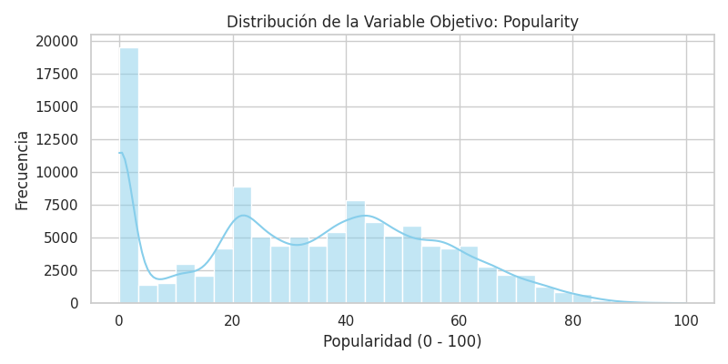

* Distribución **no normal**: media 33,3 y mediana 35, con un pico marcado en 0 y otros dos modos cerca de 20 y 42.
* **15.843 canciones (14,0%) tienen `popularity = 0`.**
* Solo **4.843 canciones (4,3%) superan 70** (hits): clase escasa para el KPI de detección.

#### D.2 Duración de las canciones

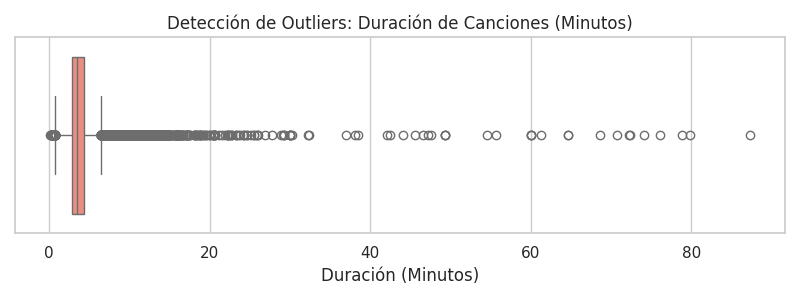

* La mayoría dura entre ~3 y ~4,5 minutos, pero hay una cola larga hacia duraciones muy altas (asimetría 10,8), lo que justifica el umbral extremo usado en la sección C.

#### D.3 Correlaciones entre atributos de audio y popularidad

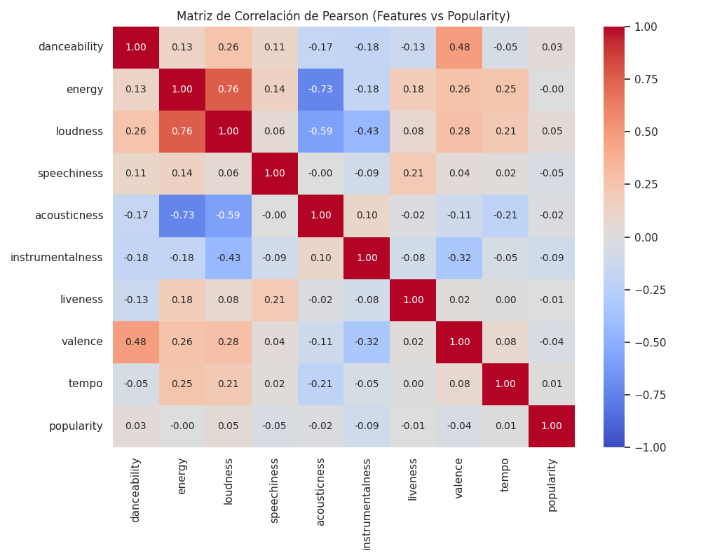

* **Con `popularity`:** ninguna variable de audio supera |r| = 0,095; la mayor es `instrumentalness` (−0,095). Ampliando a `duration_ms`, `explicit`, `key`, `mode` y `time_signature`, y usando Spearman, el máximo sigue siendo bajo (Pearson 0,095; Spearman 0,078): **los atributos de audio no bastan para explicar la popularidad**.
* **Entre los atributos:** `energy`–`loudness` (0,76), `energy`–`acousticness` (−0,73) y `danceability`–`valence` (0,48).

#### D.4 Popularidad por género

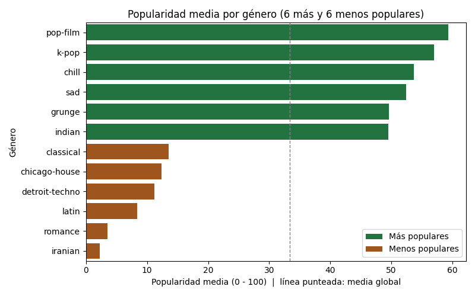

* El género explica **~25% de la varianza** de `popularity` (η² = 0,25), y ~38% si se excluyen los ceros.
* Los géneros más populares son `pop-film` (59,3), `k-pop` (57,0) y `chill` (53,7); los menos, `iranian` (2,2), `romance` (3,5) y `latin` (8,4).
* Los ceros se concentran en ciertos géneros (`jazz` 68%, `iranian` 66%, `romance` 61%, `soul` 61%): parte de la diferencia entre géneros puede deberse a cómo se asigna la popularidad y no solo al gusto de la audiencia.
* Cada género tiene entre 904 y 1.000 canciones (equilibrado por construcción).

### E. Transformación y Encoding de Variables

1. `explicit` se convierte a entero (0 = False, 1 = True).
2. `track_genre` se codifica mediante One-Hot Encoding con `pd.get_dummies(drop_first=True)`, generando 113 variables dummy. La columna `track_genre` se reemplaza por esas dummies, pero se conserva una copia de texto (`track_genre_label`) para reportes por género y para el *target encoding* del modelado; esa copia no es una variable predictora.
3. `key`, `mode` y `time_signature` se conservan como enteros.
4. **Escalamiento:** se aplicó `MinMaxScaler` (Scikit-Learn) sobre las 9 variables continuas de audio, quedando en el rango [0,0, 1,0]. `duration_ms` no se escala en esta etapa (no es un atributo de audio y su tratamiento dependerá del modelo).
5. **Nota metodológica:** el escalador se ajustó aquí con todo el dataset por ser la etapa de preparación. **Se corrigió en el modelado:** se reajusta solo con el conjunto de entrenamiento para evitar fuga de información.

### F. Selección de características

* **Se excluyen como predictoras:** `track_id` (identificador; la partición se agrupa por artista + nombre) y `artists`, `album_name`, `track_name` (texto de alta cardinalidad). Permanecen en el CSV para trazabilidad.
* **Multicolinealidad moderada:** el VIF máximo entre los atributos de audio es 4,2 (`energy`), bajo el umbral habitual de 5, por lo que no se elimina ninguna variable de audio en esta etapa.
* **Selección final: 127 variables predictoras** (9 de audio, 5 discretas o de metadatos y 113 dummies de género). Ninguna cumple un criterio de exclusión (VIF > 5 o ser identificador/texto), por lo que se conservan todas; las dummies de género se mantienen por ser la señal más fuerte.
* **Actualización (EP2):** el primer intento de modelado usa las 127 predictoras, pero el modelo final reemplaza las 113 dummies por una sola variable de *target encoding* del género, quedando **15 predictoras** (sección 6).

### G. Exportación de Datos Procesados

* Dataset limpio y transformado: `data_procesado/spotify_tracks_clean.csv` (113.549 filas y 133 columnas: 19 atributos y metadatos, 113 dummies de género y `track_genre_label`; sin nulos ni duplicados exactos; el notebook incluye validaciones automáticas).
* Registros atípicos identificados: `data_procesado/spotify_tracks_anomalias.csv` (1.256 filas, con columna `anomalia` que indica si corresponde a tempo cero o duración extrema).
* Perfiles sonoros (EP2): `data_procesado/spotify_tracks_clusters.csv` (80.286 canciones distintas con su grupo de K-Means).

## 6. Modelado: preparación para el entrenamiento

Todo se reproduce en `notebooks/02_Modelado.ipynb` (partición, modelos supervisados, evaluación de KPIs y K-Means).

| Paso | Qué se hizo | Justificación |
| :--- | :--- | :--- |
| Compás inválido | Se eliminaron las 1.130 filas con `time_signature` 0 o 1 (quedan 112.419). | Fuera del rango 3-7 de la API de Spotify; se eliminan igual que el único registro nulo del EP1. Este filtro retira también los `tempo = 0`. |
| **Partición por artista + nombre** | `GroupShuffleSplit` 80/20 (`random_state=42`) agrupando por artista + nombre de la canción en minúsculas: 64.228 canciones en train y 16.058 en test. | Agrupar solo por `track_id` dejaba **1.891 canciones en train y test a la vez** (17,8% de las filas de test), porque la misma canción tiene `track_id` distintos (single, álbum, recopilación) con audio casi idéntico en el 90,8% de los casos. Hay asserts que comprueban que no hay fuga. |
| Escalado sin fuga | `MinMaxScaler` ajustado solo con train y aplicado a test. | Corrige el ajuste con todo el dataset del EP1. |
| Hits | `popularity > 70`: 4,3% en train y 4,2% en test (933 filas). | Definición del KPI de detección de hits. |

**Unidad de análisis.** En el modelado cada fila es una canción en un género (canción × género), no una canción distinta. El MAE, el recall de hits y el porcentaje del catálogo marcado se calculan por fila, y una canción catalogada en varios géneros cuenta varias veces. Por eso la tasa de hits por fila (4,3%) no es igual a la tasa entre canciones distintas (2,9%, sección 8).

### 6.1 Baseline justo: mediana del género

| Baseline | RMSE | MAE |
| :--- | :-: | :-: |
| Media de popularidad por género | 19,25 | 14,14 |
| **Mediana de popularidad por género (oficial)** | 20,65 | **12,85** |

El MAE se minimiza con la mediana, así que la comparación justa para el KPI de MAE es contra la mediana (contra la media, cualquier modelo parece mejor de lo que es).

### 6.2 Modelos supervisados

* **Regresión Lineal:** modelo base interpretable.
* **Random Forest** (300 árboles, `max_depth=15`, `min_samples_leaf=5`): captura interacciones género × audio que la regresión lineal no ve. Se eligió por el EDA: relaciones débiles variable a variable (|r| ≤ 0,10) pero con género explicando ~25% de la varianza. La configuración se respalda con validación cruzada y una búsqueda de hiperparámetros en la sección 6.3.
* **Primer intento, con 127 predictoras (113 dummies de género):** empeora al baseline (Regresión Lineal 14,05 y Random Forest 16,71 de MAE).
* **Corrección: target encoding del género.** Las 113 dummies se reemplazan por una sola variable (promedio de popularidad del género calculado solo con train), quedando **15 predictoras**. El Random Forest pasa de 16,71 a 13,64 de MAE. **Ojo:** el primer Random Forest usaba 100 árboles con `max_features="sqrt"` y el final usa 300 árboles con todas las variables, así que esa mejora no se debe solo al encoding; no se reentrenó el primer modelo con la configuración final.
* **Limitación del target encoding:** se calcula con todo el train y sin validación cruzada, así que cada canción aporta a su propio promedio de género. Con ~900 canciones por género el aporte es mínimo. Se comprobó con una versión *out-of-fold* (`GroupKFold`): MAE 13,78 vs 13,62, es decir, el encoding usado es levemente optimista, sin cambiar la conclusión.

| Modelo (15 predictoras) | RMSE | MAE | Mejora MAE vs baseline mediana |
| :--- | :-: | :-: | :-: |
| Baseline mediana género | 20,65 | 12,85 | — |
| Baseline media género | 19,25 | 14,14 | −10,0% |
| Regresión Lineal | 19,17 | 14,08 | −9,5% |
| Random Forest | 18,91 | 13,64 | −6,1% |

* **Sobreajuste:** Random Forest MAE train 10,46 vs test 13,64 (brecha 3,18); la Regresión Lineal no sobreajusta (brecha −0,08) pero tampoco mejora.
* **Importancia de variables:** el género codificado concentra ~50%; cada variable de audio aporta entre 3% y 5,4%.

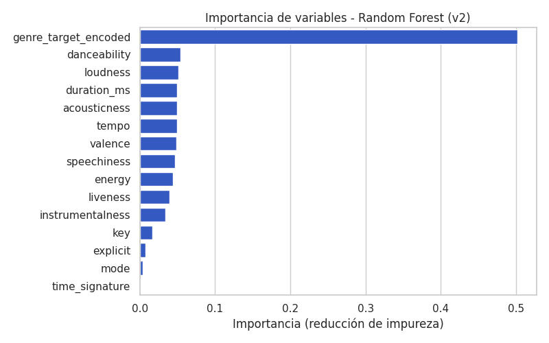

### 6.3 Justificación de los hiperparámetros

Para respaldar la configuración del Random Forest se usó **validación cruzada de 3 pliegues agrupada** (`GroupKFold` por artista + nombre, solo con entrenamiento) y una **búsqueda aleatoria de 10 combinaciones** de `max_depth`, `min_samples_leaf` y `max_features` (100 árboles por velocidad). La prueba no se usó para elegir.

| Modelo / configuración | MAE en validación cruzada | MAE en prueba |
| :--- | :-: | :-: |
| Regresión Lineal (sin hiperparámetros) | 14,17 (± 0,04) | 14,08 |
| **Random Forest, configuración actual** (`max_depth=15`, `min_samples_leaf=5`, todas las variables) | **13,78** (± 0,06) | **13,64** |
| Mejor de la búsqueda (`max_depth=20`, `min_samples_leaf=20`, `max_features=0,5`) | 13,85 | 13,68 |
| Peor de la búsqueda (`max_depth=6`, `min_samples_leaf=100`, `max_features=0,33`) | 14,95 | — |

* **La búsqueda no mejoró la configuración original**, por lo que se mantiene. Las mejores combinaciones difieren en menos de 0,1 puntos de MAE.
* El Random Forest supera a la Regresión Lineal en validación cruzada por 0,39 puntos, mucho más que la variación entre pliegues, coherente con la prueba.
* Árboles muy someros o muy restringidos empeoran el error: el modelo necesita profundidad para capturar la interacción género × audio.
* **Conclusión:** ajustar hiperparámetros no cambia el resultado. Incluso con la mejor combinación el MAE sigue sobre el baseline de 12,85, así que el límite está en la información de los datos y no en el ajuste del modelo.
* **Limitaciones:** búsqueda de solo 10 combinaciones, no exhaustiva; y el *target encoding* se calculó con todo el entrenamiento, por lo que el MAE de validación cruzada es levemente optimista (ver 6.2).

## 7. Evaluación de los KPIs

| KPI | Meta | Resultado | Cumple |
| :--- | :--- | :--- | :-: |
| MAE vs baseline (mediana del género) | ≥ 20% de mejora | **−6,1%** (RF 13,64 vs 12,85) | No |
| Hit Recall, umbral que maximiza F1 | ≥ 60% | 34,1% (precisión 14,5%) | No |
| Hit Recall, umbral calibrado en train para 60% | ≥ 60% | 65,2% (precisión 9,8%, marca 27,8% del catálogo) | Sí, a costa de precisión |
| Diferencia de MAE entre géneros | ≤ 10 puntos | 32,0 puntos | No |

### 7.1 MAE

Un gradient boosting optimizado directamente para MAE llega a 12,84, o sea **empata** con el baseline. El problema no es la función de pérdida: el audio no agrega información sobre el género.

### 7.2 Detección de hits

Clasificador Random Forest (`class_weight="balanced_subsample"`) con las mismas 15 predictoras. Los umbrales se eligen **solo con entrenamiento**, con probabilidades *out-of-fold* (`GroupKFold`, 5 pliegues y género codificado dentro de cada pliegue).

| Umbral | Recall hits | Precisión | % del catálogo marcado | Lift vs azar |
| :--- | :-: | :-: | :-: | :-: |
| F1 (0,607) | 34,1% | 14,5% | 9,8% | 3,5× |
| Recall 60% en train (0,489) | 65,2% | 9,8% | 27,8% | 2,3× |

ROC-AUC 0,779 y PR-AUC 0,147 (tasa base 4,2%). Usar el regresor como detector (predicción > 70) encuentra solo el 0,5% de los hits.

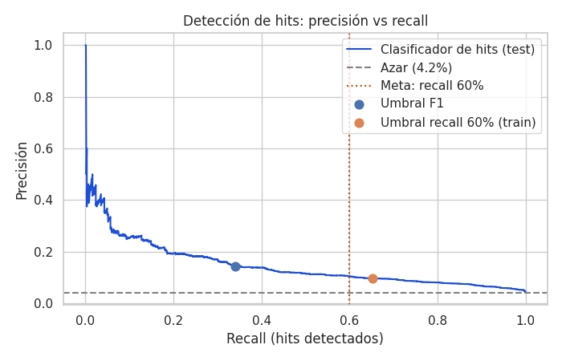

### 7.3 Error por género

Mejor género `iranian` (MAE 2,4) y peor `electro` (34,4). El modelo mejora al baseline en solo 40 de 114 géneros y empeora mucho en algunos (`dance` 33,8 vs 20,2; `alternative` 31,3 vs 23,1). Los géneros con error bajo tienen popularidades muy parecidas entre sí (desviación de 4 a 5 puntos); los de error alto mezclan canciones muy populares con muchos ceros (desviación de 33 a 35 puntos, 30-48% de ceros).

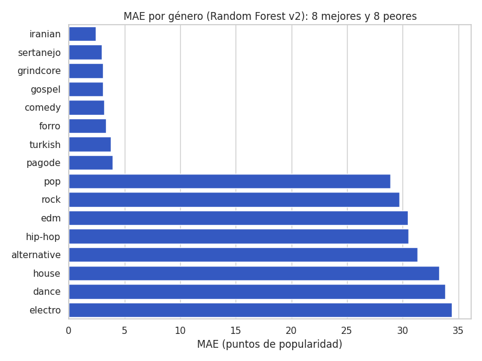

### 7.4 Modelo con y sin los `popularity = 0`

Se entrena el mismo Random Forest solo con canciones de `popularity > 0` (el *target encoding* y el baseline de mediana se recalculan con esos datos) y se evalúan ambos modelos en la prueba completa y en la prueba sin ceros. Cada uno se compara con su propio baseline.

| Entrenamiento | Evaluación | MAE modelo | MAE baseline | Mejora | Dif. mejor-peor género | Géneros que mejoran al baseline |
| :--- | :--- | :-: | :-: | :-: | :-: | :-: |
| Con ceros | Prueba completa | 13,64 | 12,85 | −6,1% | 32,0 | 40 de 114 |
| Sin ceros | Prueba completa | 14,54 | 14,76 | +1,4% | 40,6 | 58 de 114 |
| Con ceros | Prueba sin ceros | 11,13 | 11,01 | −1,1% | 35,4 | 42 de 114 |
| Sin ceros | Prueba sin ceros | 10,11 | 10,11 | 0,0% | 35,5 | 51 de 114 |

* **Entrenar sin ceros empeora el error real** (14,54 vs 13,64) y amplía la brecha entre géneros (40,6 vs 32,0). Su «mejora» de 1,4% es contra un baseline peor que la mediana con ceros (12,85).
* **Los ceros se concentran en ciertos géneros:** al quitarlos, `jazz` (+13,3 de MAE, 68% de ceros), `soul` (+12,9), `country` (+10,7) y `latin` (+8,6) empeoran mucho; los géneros con pocos ceros mejoran levemente (hasta −2,4). La correlación entre % de ceros y cambio de MAE es 0,78.
* **Sin ceros en la prueba, el modelo iguala a su baseline (0,0%):** el audio no mejora la regla de mediana por género ni siquiera cuando se excluyen los ceros.
* **La equidad no se arregla quitando ceros:** la diferencia sigue en ~35 puntos y `dance` es el peor género en tres de las cuatro combinaciones.
* **Decisión:** se mantiene el entrenamiento con ceros y se recomienda reportar el error también sin ellos. Falta aclarar con el negocio qué significa `popularity = 0`.

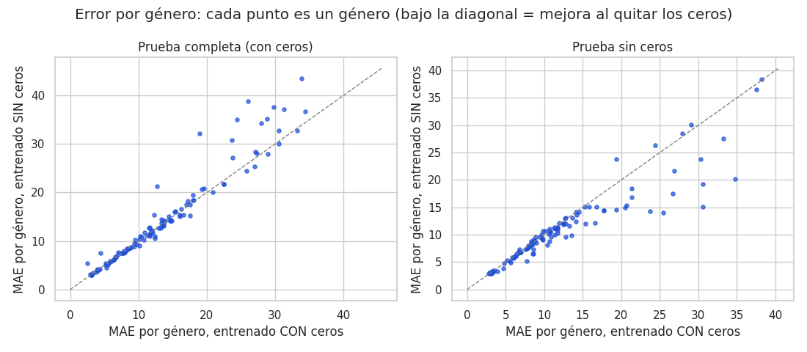

## 8. Aprendizaje no supervisado: perfiles sonoros con K-Means

**Para qué:** agrupar el catálogo en perfiles sonoros, sin usar `popularity` ni el género, para organizar playlists y campañas. La popularidad se usa solo después, para interpretar los grupos.

**Datos:** una fila por canción distinta (80.286, por artista + nombre), las 9 variables de audio más la duración en logaritmo, **estandarizadas** (`StandardScaler`) y leídas en sus unidades originales desde el CSV crudo. Sin `tempo = 0` (ya retirados por el filtro de compás).

**Elección de k:** codo, silueta y Davies-Bouldin para k = 2 a 10. La silueta es máxima en k = 2 (0,24), muy grueso para el negocio; desde k = 3 queda entre 0,15 y 0,17 sin máximo claro y el codo no es marcado. Se elige **k = 5** por interpretabilidad y manejabilidad (el grupo más pequeño, «En vivo / hablado», tiene 7,8% del catálogo). **La silueta de k = 5 es baja (≈ 0,16): los atributos de audio forman un continuo y los grupos se solapan; son una segmentación útil, no categorías naturales.** Con otras semillas se obtienen los mismos grupos (ARI ≥ 0,99).

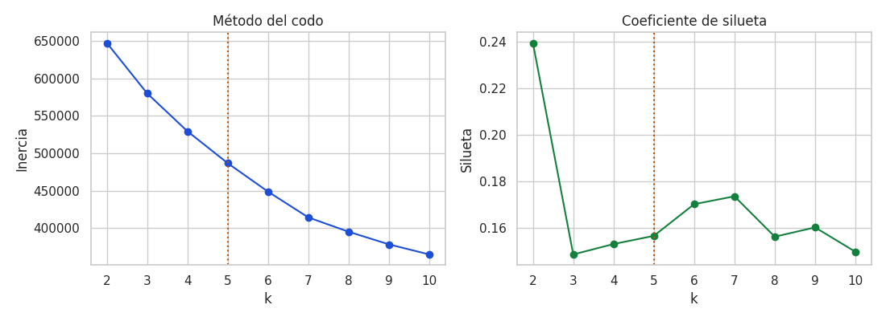

| Perfil | Cómo suena | % del catálogo | % hits |
| :--- | :--- | :-: | :-: |
| **Bailable y alegre** | Bailabilidad 0,69, valencia 0,70, energía alta, poca acústica | 34,3% | **4,6%** |
| **Acústico moderado** | Energía 0,39, acousticness 0,67, ~114 BPM | 21,4% | 2,8% |
| **Energético e intenso** | Energía 0,81, casi sin acústica, ~135 BPM, 4,1 min | 28,5% | 2,2% |
| **En vivo / hablado** | Liveness 0,75 y speechiness 0,21 | 7,8% | 1,0% |
| **Acústico e instrumental** | −20,8 dB, instrumentalness 0,78, acousticness 0,84 | 8,0% | 0,3% |

Tasa global de hits entre canciones distintas: 2,9%.

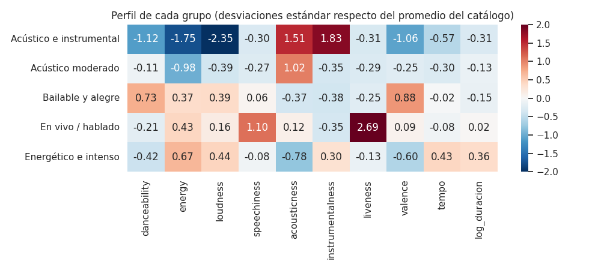
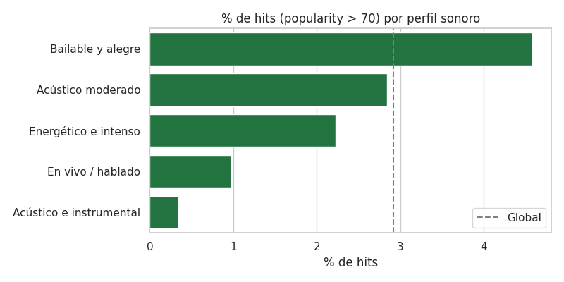
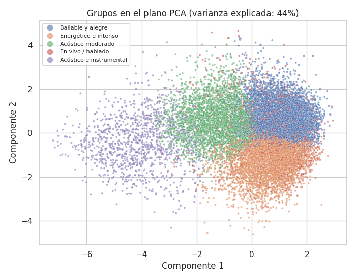

**Interpretación:** los perfiles se alinean con el género (por ejemplo, el acústico e instrumental agrupa `new-age`, `ambient`, `sleep` y `classical`). **El perfil sonoro explica muy poco de la popularidad (η² = 0,011, frente a 0,379 del género sobre las mismas canciones):** sirve para organizar el catálogo, no para predecir hits.

**Uso en el negocio:** armar playlists por perfil (contextos de uso distintos); priorizar «Bailable y alegre» para campañas de difusión; tratar «Acústico e instrumental» y «En vivo / hablado» como nichos de contexto y no medirlos con la misma vara de éxito. Que un perfil tenga más hits no prueba que sonar así cause la popularidad: está mezclado con el género y la exposición.

### 8.1 Comparación con otros algoritmos de clustering

Para justificar K-Means se compararon tres algoritmos con k = 5 sobre la misma matriz estandarizada, en una muestra aleatoria de 8.000 canciones (el clustering jerárquico no escala a 80.000 filas):

| Algoritmo | Silueta | Davies-Bouldin (menor es mejor) | Calinski-Harabasz | Grupo más chico / más grande | ARI vs K-Means | η² popularity |
| :--- | :-: | :-: | :-: | :-: | :-: | :-: |
| **K-Means** | 0,159 | 1,72 | **1.304** | 7,6% / 34,6% | — | 0,010 |
| Jerárquico (Ward) | **0,185** | **1,56** | 1.094 | **1,2% / 59,8%** | 0,29 | 0,028 |
| Gaussian Mixture | 0,031 | 3,39 | 470 | 9,5% / 35,9% | 0,14 | 0,038 |

* **Ward** tiene la silueta más alta, pero deja el 60% de las canciones en un solo grupo y uno de apenas 1,2%: no sirve para armar playlists.
* **Gaussian Mixture** es el peor en todas las métricas internas: sus grupos se solapan casi por completo.
* **Ningún algoritmo explica la popularidad** (η² ≤ 0,04 frente a 0,38 del género): la elección del algoritmo no cambia la conclusión de negocio.
* **DBSCAN no se probó:** busca zonas densas separadas por huecos y la silueta baja indica que los atributos forman un continuo.
* **Decisión:** se mantiene K-Means por equilibrio de tamaños, estabilidad (ARI ≥ 0,99 entre semillas) e interpretabilidad. Limitación: comparación sobre una muestra y con un solo valor de k.

## 9. Interpretación y recomendaciones

1. **El género domina y el audio aporta poco.** Coincide con el EDA (|r| ≤ 0,10).
2. **El modelo de regresión no supera una regla simple.** El Random Forest mejora el RMSE (18,91 vs 20,65), pero su MAE es peor que la mediana del género; además sobreajusta. No debe usarse para predecir la popularidad exacta de una canción.
3. **Lo más útil es el clasificador de hits**, como filtro previo (*shortlist*) para campañas y no como decisión final. El umbral se fija según la capacidad de la campaña: más recall significa más canciones por revisar y menor precisión (con la meta de 60% de recall, ~1 de cada 10 canciones marcadas es un hit).
4. **Organizar playlists y campañas por perfil sonoro** (K-Means), sabiendo que los perfiles casi no predicen popularidad.
5. **Incorporar datos que sí expliquen la popularidad:** seguidores o popularidad del artista, fecha de lanzamiento, presencia en playlists.
6. **Reportar siempre el error por género** y evitar usar el modelo en los géneros donde pierde contra el baseline.
7. **No eliminar los `popularity = 0` para entrenar** (empeora el error real, sobre todo en `jazz`, `soul`, `country` y `latin`), pero reportar el error con y sin ellos y aclarar con el negocio qué significan.

**Limitaciones:** la popularidad es una foto en un momento y depende de reproducciones recientes; el dataset está balanceado por género por diseño; el 14% de ceros ensucia la variable objetivo; el target encoding no usa validación cruzada (ver 6.2); y una canción con varios `track_id` y popularidades distintas conserva solo su primera fila en el clustering.

## 10. Consideraciones Éticas, Sesgos y Privacidad

| Riesgo | Descripción | Mitigación |
| :--- | :--- | :--- |
| **Sesgo de exposición y temporal** | La popularidad refleja las reproducciones recientes y la visibilidad que recibe una canción (playlists, marketing), no solo su calidad musical o acústica. Es además una "foto" de un momento y puede cambiar con el tiempo. Un modelo entrenado sobre `popularity` puede aprender y reforzar ese sesgo. | Interpretar los resultados como *popularidad observada*, no como calidad; complementar con criterio de negocio. |
| **Sesgo de muestreo por género** | El dataset contiene entre 904 y 1.000 canciones por cada uno de los 114 géneros: está equilibrado *por diseño* y no refleja el peso real de cada género en el catálogo de Spotify. Los resultados no deben extrapolarse a toda la industria. | Reportar el error del modelo **por género**, no solo el global. |
| **Ruido en la variable objetivo** | El 14% de las canciones tiene `popularity = 0`, concentradas en ciertos géneros (`jazz`, `iranian`, `romance`, `soul`). Un modelo podría penalizar sistemáticamente esos géneros. | Evaluar el modelo con y sin los ceros y auditar sus errores por género. |
| **Duplicidad de canciones** | Hay canciones catalogadas en varios géneros (35,3% de las filas) y 4.698 tienen más de un `track_id`: riesgo de sobreponderarlas y de fuga de información entre entrenamiento y prueba. | Particionar agrupando por artista + nombre de la canción y usar canciones distintas en el clustering. |
| **Uso responsable de las predicciones** | Usar el modelo para decidir a qué artistas apoyar puede favorecer siempre a lo ya popular y perjudicar a artistas emergentes o a géneros con menor exposición. | Usar las predicciones como apoyo a la decisión, no como criterio único. |
| **Privacidad** | Los datos son públicos y provienen de la API de Spotify (metadatos e indicadores acústicos). No incluyen información personal de usuarios ni datos de comportamiento individual, pero sí nombres reales de artistas. | No publicar predicciones individuales asociadas a un artista específico y respetar los términos de uso de la API de Spotify. |

### Marco normativo de referencia

* **Ley N° 19.628** sobre Protección de la Vida Privada (Chile): regula el tratamiento de datos de carácter personal, incluyendo nombres de personas reales como los artistas del dataset.
* **Ley N° 21.719** de Protección de Datos Personales (Chile): establece los principios de finalidad, proporcionalidad y seguridad, que se aplican al usar los nombres de artistas únicamente para fines del análisis exploratorio y no para decisiones automatizadas individuales.
* **GDPR (Reglamento General de Protección de Datos, UE)**, como referencia internacional: principios de minimización de datos y derecho a no ser objeto de decisiones automatizadas sin explicación, aplicables si el modelo se usara para decisiones sobre artistas específicos.
* **Términos de uso de la API de Spotify**, que restringen el uso comercial de los datos obtenidos y deben respetarse en cualquier aplicación del modelo más allá de este trabajo académico.

## 11. Metodología de Trabajo (CRISP-DM)

| Fase | Qué se hizo | Estado |
| :--- | :--- | :--- |
| **1. Comprensión del negocio** | Definición del problema, objetivos y KPIs (secciones 1 a 3). | Completada |
| **2. Comprensión de los datos** | Descripción de fuentes, inspección, calidad (nulos, duplicados, anomalías) y EDA: variable objetivo, correlaciones y género (secciones 4 y 5.A a 5.D). | Completada |
| **3. Preparación de datos** | Limpieza, encoding, escalado, selección de características y exportación (5.E a 5.G); en el modelado: eliminación de compás inválido, partición por artista + nombre y escalado solo con train (sección 6). | Completada |
| **4. Modelado** | Baselines por género, Regresión Lineal, Random Forest con target encoding y búsqueda de hiperparámetros, clasificador de hits y K-Means comparado con otros algoritmos (secciones 6 a 8). | Completada |
| **5. Evaluación** | MAE y RMSE frente al baseline de mediana, Hit Recall con umbral elegido en train, error por género, silueta y estabilidad del clustering (secciones 7 a 9). Los KPIs de MAE y de equidad no se cumplen y se interpretan. | Completada |
| **6. Despliegue** | No se despliega. No hay despliegue productivo: los modelos entrenados quedan guardados en `models/` (formato `.joblib`) y las recomendaciones están en la sección 9. | Recomendaciones |

## 12. Estructura del Proyecto

```
ProyectoSpotifyML2/
├── data/                   dataset original (Spotify_Tracks_Dataset.csv)
├── data_procesado/         spotify_tracks_clean.csv, spotify_tracks_anomalias.csv, spotify_tracks_clusters.csv
├── notebooks/
│   ├── 01_EDA_Preparacion.ipynb   limpieza, EDA, transformación y exportación de datos
│   └── 02_Modelado.ipynb          modelos supervisados, KPIs, K-Means y guardado de modelos
├── models/                 modelos y escaladores (.joblib) y parametros.json (generados por 02_Modelado.ipynb)
├── images/                 gráficos generados en el EDA y el modelado
├── requirements.txt        librerías necesarias (versiones fijadas)
└── README.md
```

### Cómo reproducir

Entorno con el que se ejecutaron los notebooks: Python 3.12.3, pandas 3.0.2 y scikit-learn 1.8.0 (versiones fijadas en `requirements.txt`).

1. `pip install -r requirements.txt`
2. Abrir y ejecutar **todas las celdas, en este orden y desde la carpeta `notebooks/`** (las rutas son relativas: `../data`, `../data_procesado`, `../models`, `../images`):
   1. `01_EDA_Preparacion.ipynb`: genera `data_procesado/spotify_tracks_clean.csv` y `spotify_tracks_anomalias.csv` y los gráficos del EDA.
   2. `02_Modelado.ipynb`: lee el CSV limpio y genera los gráficos del modelado, `data_procesado/spotify_tracks_clusters.csv` y los modelos en `models/`.
3. Las etapas más lentas son el Random Forest de 300 árboles y la búsqueda de hiperparámetros (en total, `02_Modelado.ipynb` tarda cerca de 10 minutos en un equipo de 2 núcleos; `01_EDA_Preparacion.ipynb` tarda menos de 10 segundos).

Los archivos de `models/` se incluyen ya generados para poder usarlos sin reentrenar. Si se vuelven a generar, hay que usar las mismas versiones de scikit-learn y joblib de `requirements.txt`, porque los `.joblib` no son compatibles entre versiones distintas.
